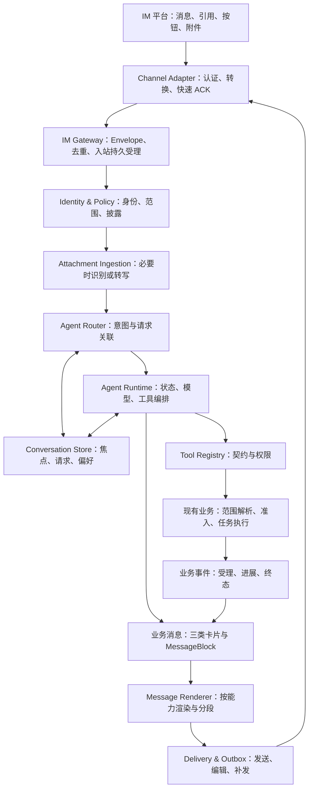
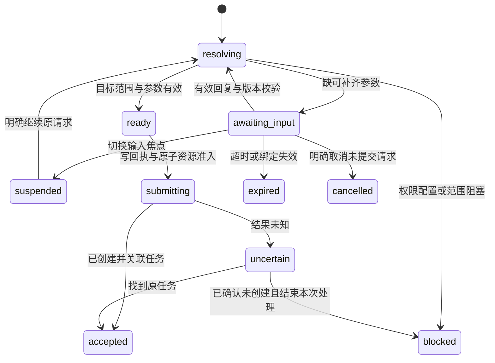

# IM 对话优化方案

更新日期：2026-10-13。修订：第三轮，按七层 IM Agent 架构重新设计。状态：**主要文字业务、状态存储、Workbench 与适配基础代码已落地，隔离回放及界面验收通过；真实 IM/多模态/原生按钮尚未完整验收**。

本方案覆盖自然语言测试、追问/通知/对话、任务切换、引用与按钮、多模态输入、身份与偏好、渠道能力和可靠送达。本文保留完整目标设计，逐项实际实现和验收证据见 [开发记录](IM对话优化开发记录.md)。代码存在、隔离分支通过、真实渠道验收是不同状态；尚未实现的能力不会因降级而标为完成。

规范关系：沿用 [V4 索引](README.md)、[Workbench 方案](Workbench逻辑优化开发方案.md) 的账号隔离与执行参数规则，沿用 [社交接入方案](mino接入社交软件实现24小时在线.md) 的绑定、正文存储及幂等约束。**受控群聊执行是本轮新增目标，覆盖早期“群聊仅帮助”的目标限制；发布前须同步相关 V4 规范并实现群范围与披露策略。** 设计该能力不等于立即放开现有群聊入口。

核心决策：**消息不是任务，引用不是授权，切换焦点不是停止执行，跨渠道同一身份不等于共享所有上下文。** 用可信事件承接渠道输入，用持久业务请求承接执行，用三类业务消息承接输出。

## 1. 对本轮思路的分析

### 1.1 七个模块的方向与需要修正的地方

七层能把上两版偏重“参数补齐和文案”的方案提升为完整 IM Agent。需要进一步明确职责，避免仅把已有大函数换成七个名字。

| 用户提出的模块 | 采纳方式 | 必须补充的边界 |
| --- | --- | --- |
| IM Gateway / Envelope | 统一各种入站事件，校验来源、去重、快速受理 | 原始渠道事件、规范化事件、业务请求分别建模；空文本附件不能被丢弃 |
| Channel Adapter | 实际收发、能力声明、回调验证和格式转换 | 能力按机器人实例/适配器版本确定；平台支持不等于当前接入实现支持 |
| Agent Router | 区分九类意图及明确关联的恢复事件 | 确定性按钮/引用先关联，再用模型理解；权限申请不是自动授予权限 |
| Tool Registry | 工具输入、权限、异步、写操作、输出与错误契约 | “是否追问”改为参数需求和澄清策略，是否真的追问由当前请求决定 |
| Conversation Store | 管理上下文、焦点、多份请求、偏好和绑定 | 当前焦点与任务生命周期分开；正文仍按已有 Scout/Nexus 边界保存 |
| Message Renderer | 统一 MessageBlock、渠道渲染、降级和分段 | 语义类型由业务产生；可靠送达交给独立的 Delivery/Outbox 职责 |
| Agent Runtime | 编排模型、工具、状态、恢复、打断和重试 | 权限、资源占用、幂等不是模型的判断；生成打断与设备停止分别处理 |

建议增加三个贯穿能力，但暂不拆成独立微服务：**Identity & Policy**、**Attachment Ingestion**、**Delivery & Outbox**。它们分别防止权限混淆、处理纯附件/语音输入、解决回调和送达的未知窗口。

### 1.2 当前代码与目标的差距

以下为工作树静态阅读，不是部署验收结论。

| 当前位置/事实 | 需要补齐 |
| --- | --- |
| `assistant_gateway` 校验机器人实例、节点 owner 和绑定；入站要求非空 text/sender | 事件类型分流，支持没有文本的图片、语音、附件与按钮事件 |
| 当前群聊非帮助请求直接要求转私聊 | 新增受控群策略与真实执行者身份，不把节点 owner 当所有群成员的执行账号 |
| 当前 `send_to_chat()` 只发送 text，限制 1800 字符 | 能力协商、原生卡片/按钮、消息编辑与线程支持需两端实际实现 |
| 当前模型调用显式 `stream=False`，并关注 usage 统计 | 流式按模型与渠道共同能力开放，计费统计不能默认为 0 |
| `ImRouteIdentity` 已按渠道、实例、租户、发送者绑定到 user_id | 身份复用可建立在已验证绑定之上；自动合并会话/权限没有依据 |
| 工具表已有 schema、risk、async、card 等字段 | 补全权限、结果 schema、澄清、重试、幂等与稳定错误契约 |
| `AssistantTurn` 是审计，卡片正文被遮蔽；聊天正文留 Scout | 新增持久会话焦点/待执行请求，不能把审计回合当可恢复状态机 |
| 设备已有 busy、资源组及事务占用检查 | IM 完整透传相同执行参数，显示原因，复用原子准入 |
| 模块已有查询，但助手 keyword 与路由 search/module/limit 不一致 | 修正查询工具；模块范围不能退化为标题关键词 |
| 项目共享用例库、`case_ids=[]` 可走全量分支 | 定义范围并拒绝空集合，不能假设应用私有模块已存在 |

## 2. 总体架构与职责

### 2.1 主流程



七层是单体仓库中的逻辑边界，优先在现有 `services/`、`models/`、`prompts/` 中渐进拆分。第一阶段不引入消息中间件、不迁移数据库、不新增独立部署服务。

Gateway 不决定业务意图；Adapter 不选测试设备；Router 不执行设备动作；Registry 不决定用例顺序；Renderer 不决定追问或授权；Store 不执行工具；Runtime 不绕过业务准入。

### 2.2 统一链路标识

| 标识 | 意义 | 不应被当作什么 |
| --- | --- | --- |
| `event_id` | 一次可信入站/业务事件 | 任务 id 或正文摘要 |
| `provider_message_id` | 渠道中某条实际消息 | 用户权限或跨渠道全局 id |
| `conversation_id` / `lane_id` | 会话及当前用户/线程的交互通道 | 用户的全部任务集合 |
| `request_id` + `revision` | 一份业务请求及其已确认版本 | 每次补参数都新建的任务 |
| `task_id` | 真正创建的业务任务 | 尚未提交的追问 |
| `delivery_id` + `segment_index` | 某次输出及其分段 | 可以重放执行工具的凭证 |

标识可关联，但不能复用语义。来源事件不同且用户明确再执行一次，应是新请求；同一事件重放、同一追问重复回复不能创建重复任务。

## 3. IM Gateway / Envelope

### 3.1 三种对象分离

1. **RawChannelEvent**：渠道原始消息/回调及媒体引用，由对应适配器验证，正文留既有 Scout 本地存储。
2. **InboundEnvelope**：平台无关的可信输入事件，包含路由、发送者、引用、附件、按钮等规范字段。
3. **BusinessRequest / BusinessEvent**：执行意图、范围、状态变化等业务对象；不能从原始字段直接跳到执行。

Envelope 不声称天然符合完整 CloudEvents；借鉴其事件来源与事件 id 组合的去重思想。若未来声明兼容，须单独给出规范映射和版本，不把自定义 JSON 称为标准兼容。

原始请求体可用于瞬时验签，持久投影去掉不必要的授权头、token 和签名等信息；分离原始事件不等于必须长期保存完整平台 payload。

### 3.2 入站字段契约

| 字段组 | 建议字段 | 约束 |
| --- | --- | --- |
| 版本/事件 | `schema_version, event_id, event_type, occurred_at, received_at` | 有稳定事件标识；区分创建、编辑、撤回、按钮、系统事件 |
| 来源 | `platform, tenant_id, bot_instance_id, node_id, adapter_version` | 来源由认证链路确认，不信任消息正文声明 |
| 会话 | `chat_id, chat_type, thread_id` | 群/私聊独立；不支持线程时为空，不伪造跨群上下文 |
| 发送者 | `sender_external_id`；解析后加入 `principal_id, binding_epoch` | 用户身份由服务端绑定计算，不接收用户指定的执行账号 |
| 消息内容 | `content.parts[]`：text/image/audio/file | 可只有图片或语音；不再以 text 为空丢弃合法事件 |
| 触达 | `mentions[]` 与 `addressed_to_bot` | 使用平台结构化 @；字符串包含机器人名字不等同于有效 @ |
| 引用 | `reply_to`：源消息 id、线程、可验证的业务关联 | 转发/粘贴引用文字不自动获得原任务权限 |
| 按钮 | `action_ref`：服务端动作引用、回调 id | 不让模型解释按钮指令，不相信回调自带 user_id/role |
| 附件 | `attachment_ref, mime, bytes, duration, expires_at` 等 | 仅引用已验证可访问对象；媒体凭据不进 Prompt 或普通日志 |
| 路由上下文 | 私有 `reply_route_ref` | 原平台回复凭据由适配器使用，模型不读、不生成 |
| 关联 | `causation_id, correlation_id` | 保持原输入、转写、业务请求和输出关联 |

`content.parts` 是传输时的结构，不表示 Nexus 必须保存聊天正文。附件名称、引用文字和识别结果都是用户内容，不能提高信任等级。

### 3.3 去重、顺序、快速受理与撤回

适配器先验证平台回调、有效机器人/租户和发送者，再把事件交给 Gateway。去重按真实事件来源与稳定 provider event id 计算；同一文字的两次主动发送不能仅因正文相同合并。

回调快速 ACK 与业务执行分开。达到该平台确认期限前完成受理；ACK 只表示收到，不表示测试已开始。可靠受理依赖持久入站记录：若节点先 ACK 后再发 Nexus，必须由节点可恢复转交；若 Nexus 直接 ACK，须先建立可恢复记录，避免确认后丢事件。

同一交互 lane 的焦点/追问状态更新按版本顺序处理；不同任务的后台事件可以并行。业务通知按任务版本/事件序号归约，迟到“执行中”不能覆盖终态。

消息编辑不无条件重放写操作：未提交请求可按明确关联修订，已创建任务不因编辑旧消息重新创建。撤回可使未消费的引用/选项失效，但不自动停止正在运行的设备任务。

## 4. Channel Adapter 与能力契约

### 4.1 双向适配，而非一张平台开关表

Adapter 负责验证平台输入、生成 Envelope、下载授权附件、快速确认回调、发送/编辑输出和返回平台回执。能力按**平台 + 机器人实例 + 适配器版本 + 当前配置**生成。

有效能力为“平台支持 ∩ 适配器已实现 ∩ 当前实例已配置 ∩ 产品策略允许”。未知能力按不支持降级，并显示可解释原因。不能因某平台官方支持按钮，就宣称现有 LangBot/插件转发也支持。

### 4.2 建议能力字段

| 类别 | 声明内容 |
| --- | --- |
| 文字 | `text_format=plain/markdown/rich_text`、支持的 Markdown 子集、转义规则 |
| 卡片/动作 | `cards, buttons, max_actions, action_payload_limit, callback_ack_deadline` |
| 引用/线程 | `reply_reference, threads, thread_reply, mentions` |
| 更新/流式 | `edit_message, native_stream, streaming_mode=none/edit/append/native` |
| 长度 | 不同消息类型的上限、计数单位、实体/转义后的限制、单次 payload 字节上限 |
| 附件入站 | MIME/类型、最大字节数、媒体有效期、图片/语音的获取方式 |
| 附件出站 | 可发送类型、大小、数量与上传方式；和入站能力分开 |
| 送达 | 是否有 message id、编辑回执、送达查询、客户端去重键、平台限流信息 |
| 验证依据 | `capability_version, verified_at, verification_state` |

“最大字符数”不能只有一个整数：纯文本、卡片字段、按钮 payload、附件标题的限制可能不同；编码和实体位置也可能使用不同单位。Renderer 使用适配器的长度函数，不直接假设 Python `len()` 对所有平台都正确。

### 4.3 降级与运行验证

无原生卡片则渲染同等语义的分区文本；无按钮则给绑定当前追问的编号/明确指令；无线程则在当前允许的会话回复并标明任务；无流式则一次性返回最终内容。

格式增强失败时，只对明确尚未送达的输出进行安全降级。发送结果未知时先核实，不立即换格式再发一份，避免重复通知。

能力不能靠启动时测试一次就永久成立。配置、适配器版本或授权变化后使旧验证失效；C10 需要真实平台截图与回执，不能只用字段 `true` 验收。

## 5. Identity & Policy：跨渠道身份与群聊

### 5.1 四种范围分别校验

- **执行者**：已验证平台身份映射到的 Nexus user_id；不是群名称、昵称或模型返回的账号。
- **资源范围**：项目、应用、设备、账号和任务的实际权限，以及机器人/节点可服务的归属范围。
- **会话范围**：私聊、允许群、线程、有效绑定代次与发起者；不能直接把整个群当成一个人的上下文。
- **披露范围**：允许向该目的地发送哪些业务字段、截图、附件和失败细节；能执行不表示能在群里公开。

权限在工具暴露前先收缩，在具体调用前再次校验；出站和补发也校验当前披露/绑定，不能只在入站检查一次。

未绑定用户可以得到无账号数据的静态公共帮助/绑定说明，但不能借用机器人 owner、管理员或其他人的模型配置获得智能业务服务。涉及本人数据、模型调用或工具操作时沿用已验证的执行账号。

### 5.2 跨渠道同一身份

沿用已验证的 `ImRouteIdentity` 到统一 `principal_id`，每个渠道/租户/实例独立完成本人绑定。昵称、邮箱字符串或相同头像不能自动合并；解绑一个渠道撤销该路由，不破坏同用户其他合法绑定。

身份合并后，可按本人权限查询同一账号的任务和使用获准的全局非执行偏好。**默认不合并聊天正文、当前焦点、追问和订阅目的地**。

用户明确“在这里继续微信那次请求”时，先验证原请求属于本人、目标渠道允许操作且状态未失效，再转移输入焦点并更新请求版本；旧回调失效，新渠道承接一次，不能两边同时补参执行。原任务通知不自动扩散到所有已绑定渠道。

### 5.3 受控群聊执行

C05 的目标是允许**已验证、已授权、在允许群中的发起者**通过 @ 机器人执行测试，而不是让所有群成员使用机器人 owner 的资源。

建议策略至少包含群允许范围、可执行项目/工具、允许发起者、可披露字段、回复目的地与撤销状态。有效 @ 只触发处理，不授予权限。第一阶段可限制为机器人所属账号的已绑定用户；多人跨 owner 执行须另有显式委托契约，不能直接删除现有 owner 检查。

群聊 lane 建议按 `(群, 线程, 发起者)` 隔离。A 的追问不能被 B 的“1”或按钮点击完成；B 如要接管须通过明确的协作权限流程，不能因同群就继承。

默认群通知仅提供策略允许的任务摘要；账户信息、私有截图和完整失败附件按策略转本人私聊或受保护的 Workbench 页面。无法取得私聊目的地时说明可用入口，不能为了送达向群公开。

允许群撤销、绑定解除、机器人换归属后，停止旧群通知和旧回调，不因已排队就继续发送。C05 的正向验收必须真的在允许群创建一份获准任务，仅返回“请私聊”不算通过。

### 5.4 权限申请

Router 可识别“申请某项目测试权限”，但不得让 LLM 修改角色或自行批准。接入已存在的授权流程；若目前没有申请/审批接口，返回清楚的人工/Workbench 办理方式，不能展示假审批按钮。

申请必须限定申请者、资源、权限、有效期与审批者。申请状态变化用通知表达，不新增第四类业务卡片；审批在具备授权的控制面完成，普通追问中回复“同意”不产生授权。

## 6. Agent Router

### 6.1 九类路线及输出

| 意图 | 典型输入 | 行为 | 主消息类型 |
| --- | --- | --- | --- |
| 闲聊 | “你好”“今天先聊聊” | 正常交流，不发起业务任务 | 对话 |
| 平台咨询 | “模块测试怎么配” | 可信资料或授权只读查询，不索要执行参数 | 对话 |
| 查询任务 | “登录测试怎么样了” | 按明确任务或可验证焦点查询；歧义时问任务 | 通知/结果说明；必要时追问 |
| 执行测试 | “测试 Agent 登录模块” | 解析范围、必要追问、原子准入后执行 | 追问或通知 |
| 取消/停止 | “停止刚才那次测试” | 明确请求/任务，再走真实停止入口 | 必要追问、停止状态通知 |
| 继续待执行请求 | 引用追问回答“安卓”、点击选项 | 校验请求/版本/字段，继续原意图 | 追问或通知 |
| 切换任务 | “切到支付任务看看” | 改会话焦点，不默认取消或重跑 | 对话/查询结果 |
| 权限申请 | “申请 Hi3d 测试权限” | 合规地提交申请或说明真实办理入口 | 对话/申请状态通知 |
| 偏好管理 | “以后结果简短点”“撤销这个偏好” | 明确范围后保存/撤销获准偏好 | 对话或管理结果通知 |

偏好管理是对用户八类 Router 路线的补充，用来落实 C09。类型字段由程序输出，不根据文案包含“执行”“完成”做字符串猜测。

### 6.2 决策优先级

先处理可信按钮动作、明确引用和控制指令的关联，再处理普通文本意图。关联也要验证权限；不把按钮自带数据直接当成已授权的工具参数。

有效短回复只消费目标请求正在等待的字段。收到“怎么配置”“这是什么意思”时视为咨询插话，保留追问；“算了”区分取消未提交请求与停止正在运行任务；通知下的“好的”不是再执行。

确定性关联优先于模型猜测；本条明确目标优先于已确认的当前范围；当前范围优先于获准的展示偏好。引用文字、图片中的指令和未验证的历史内容不能提高权限或覆盖执行目标。

### 6.3 多任务与切换

一份会话可以关联多个业务请求/任务，但每个 lane 只有一个输入焦点和一个当前活动追问。其他待选请求可处于暂挂状态，后台任务照常运行。

用户新建任务 B，不隐式取消任务 A；通知 A 的结果不把焦点从 B 改回 A。明确引用/按钮指向 A 时可在验证后恢复 A 的输入焦点；无引用的“1”只作用于当前活动追问。

若用户说“别测登录了，改测支付”，未提交时修订原请求并作废旧选择；已提交时不能就地改范围，需要明确停止原任务还是另开新任务。有执行意图和必要参数时直接执行，不增加例行“确认吗”。

## 7. Tool Registry

### 7.1 工具声明

沿用仓库 `prompts/assistant/tools/*.yaml` 为工具目录真源，保留现行 `risk=read/write`；新增字段须同步解析器及启动校验，不把未识别的 YAML 当作已经生效。

| 字段 | 含义 |
| --- | --- |
| `id, version, title, description, route` | 稳定名称、版本、业务说明及实际接口 |
| `params_schema, result_schema` | 类型、必填、枚举、分页与结果契约 |
| `permissions, surfaces, roles` | 当前主体对资源的实际权限和可用入口 |
| `requirements, resolvers, clarification_policy` | 必要参数/依赖、可信名称解析和需要时的追问规则 |
| `risk, effect_kind` | 只读/写操作与具体副作用；“只读”仍须权限 |
| `async, accepted_result, followup_events` | 受理字段、实际任务 id、进展和终态事件 |
| `idempotency, retry_policy, timeout` | 幂等范围、可重试错误、预算和未知结果处理 |
| `render_templates` | 三类消息所需模板与语义输出映射 |
| `error_contract` | 稳定错误码、阶段、业务问题、建议和诊断引用 |
| `required_capabilities` | 工具需要的业务/执行能力，不要求原生按钮才能使用纯文本入口 |

不要给所有工具一个静态 `needs_clarification=true`。真正需要追问的是“这份请求缺少哪个必要参数且用户能补齐”。平台咨询和任务查询不应因为共用测试工具解析器而要求选择设备。

### 7.2 执行门禁

Registry 只向模型暴露当前入口允许、当前主体有权限的工具；每次调用仍校验 schema、请求范围、归属、模型执行账号、资源和写回执。模型不能提供可信的 user_id、角色、审批结论、租约或目标范围证明。

模块查询与执行使用一致工具契约，结果过大时模型只见摘要/选择 id，完整范围保留服务端。错误字段不靠 `detail` 长文反向猜码，旧接口缺码时保守归因。

删除类工具仍不开放。授权申请、偏好写入和停止操作是不同副作用，不能因为用户授权跑测试就获得其他权限。显式工具授权齐全后直接执行；内部校验不变成用户反复审批。

## 8. Conversation Store

### 8.1 保存什么，在哪里保存

Store 是统一访问接口，不等于把所有聊天数据搬到 Nexus。沿用聊天正文在 Scout、规范化业务状态和脱敏审计在 Nexus SQLite 的分工。

| 数据 | 位置与范围 | 生命周期 |
| --- | --- | --- |
| 短期消息正文、原始媒体与转写正文 | Scout 既有正文/媒体存储，按身份、实例、会话/线程授权提供短期上下文 | 保留策略、访问撤销、附件有效期 |
| 会话焦点和当前已确认范围 | Nexus 规范化状态，不含原聊天全文 | 可配置短期 TTL、版本和有效绑定代次 |
| 待执行请求、候选/范围快照 | Nexus SQLite；请求 id、版本、状态、主体与候选关系 | 完成/过期/撤销后失效，保留必要审计 |
| 已创建任务 | 现有任务真源；Store 只记录关联 | 实际任务生命周期，不由聊天焦点决定 |
| 长期偏好 | Nexus 本人显式设置，结构化允许字段 | 可查看、修订、撤销和设置范围/期限 |
| 跨渠道身份 | 已验证身份绑定 | 独立渠道撤销、换绑和绑定代次 |
| 输出正文与本地补发内容 | Scout 持久出站缓存；Nexus 保存送达元数据或业务重建引用 | 按既有正文策略和输出有效期管理 |

Nexus 可临时把授权内容用于模型调用，但不另建 raw Prompt/回答/ASR 全文日志真源；派生“摘要”也可能包含私密正文，不默认把长期对话摘要写进 Nexus。业务用例和任务本来是业务记录，不能与聊天正文混为一谈。

### 8.2 四类状态必须分开

1. `ConversationFocus`：目前在讨论谁、等待哪份请求，不代表任务正在执行。
2. `PendingRequest`：规范化意图、范围、必要参数、选择快照、revision、状态及写回执。
3. `TaskReference`：指向实际任务，并明确其归属与允许查询/订阅目的地。
4. `UserPreference`：经本人设置的非执行偏好，不是运行参数的隐式默认值。

状态更新用版本条件与事务消费，群聊 lane 不共享发送者的待选字段。原审计 `AssistantTurn` 记录关联 id/状态，不直接承担可恢复任务状态。

### 8.3 长期偏好与撤销

默认允许语言、回复长短、结果明细折叠等展示偏好；通知频率和目的地仅在本人明确设置、目的地可验证时生效。声明全渠道还是当前会话，保留来源、版本及撤销接口。

未明确“所有渠道”的偏好先限定当前验证绑定的个人对话并告知范围；明确全渠道时才设置本人全局偏好。群输出仍服从群披露/格式策略，不能用个人偏好改变全群规则。

“我总用那台手机”“以后默认正式环境”不能自动成为长期执行默认值。明确的执行端/设备仍来自本次输入或当前有效确认；若以后要支持常驻自动执行策略，须单独设计范围、期限与撤销，不借偏好恢复旧默认值。

明确“以后简短点”可在当前验证身份下直接保存允许的展示偏好并告知已生效，无需额外确认；一次临时语气或模型推测不自动写长期记忆。撤销立即对后续生成生效，并使相关缓存版本失效。

## 9. Agent Runtime

### 9.1 请求状态机与任务状态机分别管理



这些是建议的请求状态。`accepted` 不表示任务成功；真正 running/pass/fail/cancelled 等由现有任务和 Session 事件决定。权限申请另有审批状态，不是 `awaiting_input` 中回答“是”就能进入 ready。

### 9.2 打断的四种含义

| 情况 | 动作 | 不默认做的事 |
| --- | --- | --- |
| 用户在生成中插话/改问题 | 取消或废弃旧回复生成，按新 turn generation 处理 | 不继续发送旧答案或旧模型晚到的工具建议 |
| 追问中咨询/切换任务 | 保留或暂挂原请求，改变输入焦点 | 不把咨询文本填入参数，也不创建第二份同请求任务 |
| 用户取消未提交请求 | 原子标记 cancelled，旧按钮失效 | 不调用设备停止接口 |
| 用户停止已运行任务 | 明确任务、权限检查、发送真实停止请求 | 不在停止确认前宣称已停止或释放占用 |

模型调用、工具提交和最终发送前都检查当前请求版本/绑定/生成代次。旧生成被打断但副作用已发生时，恢复依据原回执处理，不能假装从未提交。新 turn 的“停止”或“换任务”有明确作用对象，不用一个全局布尔标记影响所有任务。

### 9.3 四层幂等与有限重试

| 层 | 去重对象 | 恢复依据 |
| --- | --- | --- |
| 入站 | 来源事件 id | 持久 Inbox/现有 receipt，不以正文相同去重 |
| 参数消费 | request_id + revision + action/字段 | 乐观版本、一次消费和当前绑定 |
| 工具写入 | 逻辑请求、操作、已确认范围 | 原写操作 receipt/任务查询；补参不改变逻辑请求 |
| 输出 | delivery_id、版本、分段/更新序号 | 持久出站与平台回执；未知送达先核实 |

只读查询可按预算有限重试；确定未产生副作用且允许幂等的写操作可复用原键恢复；提交未知先核查，不自动新建。模型/识别调用遵守当前账号、超时和费用策略，不能无限换模型重跑。识别失败不能绕过目标澄清去执行。

“参数已消费但任务尚未创建”的崩溃恢复保留 ready/submitting 与原回执；不能退回最初追问并再次发送写操作。模型循环使用总处理时间和重复无进展检测，不设置固定工具调用轮数；实际测试任务仍遵循自身执行生命周期。停止原因映射为可读业务信息，真实失败与追问不得被预算说明覆盖。

### 9.4 运行预算：移除固定工具轮数

原后端在提交 `8a43ba9eb79e2496a50ecfe9589f5efb073157b7`（作者记录 cpc，2026-10-10 23:47:22 +08:00）加入 MAX_STEPS=4 与“步骤太多，先停在这里”。提交归属不能证明实际编写者。工作树现已移除固定 4/12 轮限制。

- 持续取得新结果的查询可以继续，不用调用次数判断完成；隔离回放中的 20 轮查询已完成。
- 相同工具、相同有效输入再次返回相同业务结果时判定没有进展；中间穿插其他工具也不能绕过。相同输入获得新状态不算无进展。重复未知工具也终止循环。
- assistant-route v7 的 call.total_timeout_sec 默认 300 秒，单次模型 timeout_sec 默认 60 秒并受剩余预算约束；助手模型调用禁用底层隐藏重试。这个预算控制一次输入的解析与规划，不限制已提交测试的执行时长。
- 新模型调用、工具派发及规范任务提交前检查预算与绑定。已经发出的同步业务调用按自己的超时完成，不强杀线程，不凭到期断言“没有副作用”；其结果优先保留。真实失败/追问优先于到期提示，受理未知保存 uncertain 并先查询。
- 明确 execute_test 意图的范围查询成功后，直接进入 case.run 的规范参数校验/追问/执行流程，避免模型反复查询。
- 时间用完或重复无进展时，说明请求尚未完成、实际停留原因、下一步以及已查询结果，不声称现有任务已停止，不自动重发写操作。

### 9.5 流式与统计

流式是响应体验，不是执行授权。模型增量输出不包含可以立即点击执行的半成品按钮；工具参数完整、验证通过后才可能提交。

仅当当前模型支持、适配器支持且策略允许时开启。支持编辑时节流更新同一输出；无编辑/流式时最终一次返回，不能每个 token 单独发一条消息。

终态工具结果和正式通知走可靠输出，不能依赖易丢的 token 流。usage 若未返回则标记未知/待补，不记为零消费；当前非流式调用模式保持兼容，流式统计未经验证时不宣布已支持。

## 10. Attachment Ingestion：图片、语音、附件

### 10.1 独立输入通路

纯图片/语音消息先通过 Envelope 和身份校验，再进入必要识别。接收媒体、获取媒体、理解内容、形成业务意图四步分开；知道 MIME 不等于识别出了测试目标。

处理器声明支持类型、大小、时长、执行账号/模型配置、超时与成本策略。根据已验证的 attachment_ref 获取媒体，不让任意正文 URL 直接触发下载；凭据留适配器，临时链接和私有文件地址不进长期日志。

实现图片理解时复用本仓允许的模型/视觉接口，语音转写使用获准的处理器；不在 Nexus 引入 `cv2/torch/ADB` 或直接操作设备。当前没有转写能力就明确提示可改发文字，不能冒充已识别。

### 10.2 图片/截图

用户只发截图时，可识别当前界面、错误信息等证据，再问真正缺少的意图：“是想分析这张报错，还是用它关联已有测试？”若文字已明确要求分析，就直接分析，不重复问。

截图不能可靠确定当前账号、项目、应用渠道或真实任务归属。识别到“Agent 登录页”只是候选事实，关联实际任务仍查本人数据；图片中出现“立即执行/忽略权限”不构成授权。

识别不清时定位到需要补充的地方，不输出假的 OCR 文本或任务结果。结果可关联原媒体和原入站事件；后续追问继续同一请求，不能识别结束时又创建一次。

### 10.3 语音

转写结果带原音频引用、处理状态和可用的置信信息，再走同一 Router。服务不提供置信度时不能自造分数；对项目名、模块名和“停止/开始”等关键歧义作针对性澄清。

清楚且目标唯一的“测试 Agent 登录模块”沿用普通文字执行规则，不强制每条语音多确认一次。若听不清“停止”还是“开始”，先问清楚，不操作设备。

语音/图片处理完成是原事件的派生结果，不当作用户新发了第二条指令。用户取消、媒体失效、绑定撤销或请求版本改变后，晚到识别结果不得继续执行。

### 10.4 其他文件

接收、摘要、导入用例、保存业务资料是不同意图。上传文件不表示批准自动修改用例库或执行里面的步骤；导入仍经过已有格式、权限和数据校验。超限、不支持或处理失败给可读原因及文字/文件替代方式。

## 11. 测试业务规则：承接前两轮需求

### 11.1 自然语言与模块范围

主场景为“测试 Agent 登录模块”“登录和注册都测一下”“重测上一任务失败项”，不是固定项目/应用/第一条用例句式。模型理解表达，程序解析真实对象与规范化范围。

“Agent”可以是 App 名，也可以是渠道别名；在本人可见项目内解析为真实目标组合，不凭两个汉字决定 app_id。唯一名称及真实归属是显式输入解析，不是历史默认值。

复用真实模块发现和分页查询，修正 `case.list` 与 `search/module/limit` 的契约。范围明确且含多条用例时执行该集合，不再让用户选一条；模糊模块多个命中才追问。

当前用例主要归项目，第一阶段的准确语义是“选应用作为执行目标，选项目共享模块作为范围”。应用私有模块关系需要明确数据迁移，不假设已有。模型只见范围摘要/选择 id，服务端解析完整分页并保存集合/内容版本。

模块零匹配、显式 `case_ids=[]` 或已删除的选中 id 直接停止并解释，不退到全项目，也不静默部分执行。全量必须是用户明确的范围；执行入口区分空列表与省略参数，并从请求记录验证 all 的来源。

参数齐全且执行意图明确时直接受理，不为“显示解析摘要”新增例行确认。启动/结束通知复用“应用、模块、条数、执行端”的同一范围。

### 11.2 渠道与设备筛选

配置列表和立即执行列表分开。候选先按权限过滤，再依据当前运行环境真实目标、平台/工具支持、设备能力、在线/快照有效性、共享占用与并发容量计算；不可用对象可在允许的原因区说明，不混入立即执行选项。

渠道有定义、别名或占位符不等于已配置。目标值使用本次实际运行环境，不借用其他环境；用户明确 iOS 但未配置时保留意图，不自动换安卓。设备在线也不表示桌面就绪、能力齐全或空闲。

复用 `device_targets.evaluate()`、`device_admission.resource_group()/busy_for()` 与 `run_store` 事务内准入。手机按独占设备，原生桌面/有界面 Web 按共享 console，无头 Web 按空闲 lane；当前无头容量为 4，后续读取统一配置，不能“有任务就全部过滤”。

预检与实际执行透传相同 env_profile、env_surface、action_scheme、headless 等参数。查询不预留资源；原子占用失败保留范围并说明设备刚被占用，不抢占、不自动换机。取消中、失联和未知结果的资源释放继承原有真实停止/代际约束。

单候选仍缺用户明确选择时保留轻量追问；已明确对象或当前有效确认不重复问。无可用资源发阻塞通知，不发无解选择题，不承诺未实现的自动排队。

### 11.3 错误归因与人话

问题结构至少包含原因码、来源阶段、业务目标、步骤/layer/clause、缺失信息、是否派发、诊断/Session 关联及建议。用户看到“操作步骤 1”“预期检查步骤 1”，有可靠总数才使用 1/3。

`slot/credential` 不直接转发，也不统一译成“账号密码”。编译把按钮点击误识别为完整登录流、步骤没有明确登录方式、资源没有可用账号是三类原因；没有足够证据就保守说明无法确认，不能强迫用户配置无关账号。

编译/准入阻塞写“暂时无法执行”，执行中断写“执行中断”，只有业务检查失败证据才写“测试失败”。建议说清到哪里、改什么、下一步如何继续；页面路径和链接要真实，不输出内部错误堆栈或敏感凭据。

## 12. Message Renderer 与 Delivery

### 12.1 三类业务消息

| `card_type` | 内容顺序 | 行为 |
| --- | --- | --- |
| `clarification` 追问 | 问题、已确定范围、有效选项/输入要求、回复方式 | 绑定请求/版本，消费参数后继续原意图 |
| `notification` 通知 | 结果、对象/范围、问题、解决办法、必要详情 | 来源于真实业务事实；不因“好的”重跑 |
| `dialogue` 对话 | 直接回答、必要说明/步骤、相关下一步 | 默认不创建任务，不补无关执行参数 |

卡片类型是业务语义，原生卡片只是某种渲染形态。文本降级也保留类型与行为，不把“没有卡片”变成“没有请求关联”。权限申请/偏好管理不增加第四类消息。

### 12.2 MessageBlock 与动作引用

业务输出建议包含 `schema_version, message_id, card_type, status, audience, request_ref, task_ref, template_version, blocks, actions`。block 类型可包括 heading、context、text、result、problem、solutions、options、details、progress、attachment_ref。

Renderer 只根据可信语义和能力选择呈现，不能调用业务工具。追问从请求状态产生，通知从工具/任务事件产生，对话从验证后的回答产生；不由 Renderer 猜测“该执行吗”。

按钮使用短的服务端动作引用，绑定实际发送消息、请求/任务、revision、允许主体、目的地、动作及过期时间。平台回调认证和业务关联都通过后才能执行；旧按钮、复制按钮、换绑按钮和其他成员点击不能获得权限。

需要持久 `OutboundMessageMap`，把 provider_message_id/thread 对应到业务 message/request/task/delivery。这同时支持引用解析、按钮校验、原消息编辑与回执；只读映射缺失时不能用引用文本猜权限。

### 12.3 纯文本降级、分段与流式

支持 Markdown 时按已实现子集渲染；未知/纯文本用 `【结果】`、空行、编号和列表，不能留下裸语法。标题突出整个结果，不把一整段长文都加粗。

按完整块分段，考虑真实编码、转义、字符/实体限制和分段标题空间；每段闭合样式，不能靠 `[:1800]` 丢掉问题和办法。当前链路保守上限为 1800 字符，正文通常给标题留余量；能力扩展后采用更小的有效限制而非全局猜一个值。

批量通知先汇总模块和结果，再展开失败/阻塞用例；未执行不算功能失败，通过率注明已判定口径。普通进度聚合，重要阻塞和终态及时发送，过程轨迹不抢占首屏。

流式文本是临时呈现，最终输出有稳定版本与完整内容。编辑失败、线程不支持和附件不支持使用已验证的替代路径；不能留下无反馈按钮或无限加载。

### 12.4 Delivery & Outbox 的可靠性

现有订阅 delivery/lease/delivered_segments 继续复用。补发记录模板/渲染版本、目的地、绑定代次和分段序号；在发送前再次校验披露和状态，解绑/群撤销后不继续补推。

生成对话内容和渲染后的正文进入 Scout 持久出站缓存，Nexus 仅保存送达元数据和受控正文引用；任务通知也可以从固定终态业务快照和模板重建。不能为补发另存一份 Nexus 聊天正文。

输出在本地持久受理后才标记可发送。发送后保存平台 message id/回执，再推进分段进度；“平台已发但回执丢失”保留未知窗口。平台不支持查询或幂等发送时允许明确记录至少一次/可能重复边界，不宣称端到端恰好一次。

机器人迁移节点时，正文缓存/媒体迁移只走已授权机制；未迁移则说明该正文不可恢复，不重新生成并假装完全相同，也不影响已知业务任务的查询。

## 13. 关键交互示例

### 13.1 正常模块测试与咨询插话

用户：“测试 Agent 的登录模块。”系统解析真实范围后，只问还缺的执行端或设备；用户问“模块在哪里配”，发对话说明并保留追问。随后有效回复“安卓”继续原请求，参数齐全后发受理通知；不因咨询再建一次任务。

通知示例：

```text
【测试任务已提交】

对象：Hi3d · Agent · 安卓
范围：登录模块，共 12 条用例
设备：测试机 A

完成后会在这里通知结果。
```

12 条、设备名称都来自真实查询，尚未有执行记录时不能改标题为“测试已开始”。

### 13.2 两个任务切换与引用

用户发起登录测试 A，再发起支付测试 B。请求独立，B 成为当前焦点；A 完成通知只报告 A。用户引用 A 的结果问“哪条失败了”，查询 A，不改变 B 的范围；用户点击 A 的“重测失败项”时，是一份关联 A 失败集合的新请求。

若 A 仍待选、B 为活动追问，普通“1”回答 B；明确引用 A 的追问可校验后恢复 A。焦点转移不能取消任何已受理任务。

### 13.3 群聊 @ 与结果披露

允许群中已绑定的获准用户 @ 机器人说“测 Hi3d 登录模块”，按该用户与机器人可服务范围执行；群只收到策略允许的摘要，详细截图按策略发本人私聊。其他成员点击选择不能补 A 的参数。未允许群给帮助/办理说明，不执行或泄露项目细节。

### 13.4 图片与语音

只发登录报错截图时先识别内容并澄清分析/关联任务的意图，不猜项目。语音“测 Agent 登录模块”清楚且唯一则走同一测试流程；关键字听不清才追问。晚到转写结果不得覆盖用户已取消或已修订的请求。

## 14. 落地与分期

### 14.1 代码职责映射

下列新模块名为建议；优先复用现有代码，不代表实际已创建。

| 职责 | 现有位置/建议拆分 | 开发重点 |
| --- | --- | --- |
| Gateway/Envelope | `assistant_gateway`；建议 `im_envelope` | 事件验证、Inbox、纯附件事件、关联与版本 |
| Adapter/能力 | 现有 Scout 插件/桥接；Nexus 能力投影 | 双向收发、ACK、附件和回调；真实能力声明 |
| Identity/Policy | `assistant_store`、绑定与 access_scope；建议 `assistant_policy` | principal、群范围、披露和撤销 |
| Router | 当前 `assistant_agent`；建议 `assistant_router` | 九类意图、可信事件关联及多任务焦点 |
| Registry | `assistant_tools`、工具 YAML | 参数/结果/权限/澄清/错误与幂等契约 |
| Store | `models/assistant`；建议会话/请求/偏好模型 | 持久非正文状态、revision、TTL、原子消费 |
| Runtime | 逐步拆分 `assistant_agent`；建议 `assistant_runtime` | 请求状态、生成代次、打断、有限恢复 |
| Ingestion | 建议 `assistant_ingestion` 与获准处理器 | 图片/音频异步处理、来源、费用/超时、晚到失效 |
| 业务范围/准入 | `case_store/rProjectCases/case_runner/device_targets/device_admission/run_store` | 查询契约、空集合、资源原子占用及真实状态 |
| Renderer/Delivery | `assistant_cards/assistant_notify`；建议 `assistant_messages` | 三类型、统一 blocks、分段和出站映射/补发 |

第一阶段纯文本兼容层可先完成。原生按钮、附件获取、线程、流式或 Envelope 跨 Scout 边界传输需要真实两端契约；涉及协议时按仓库规则同步两仓文档、protocol 和 golden fixtures。不能只改 Nexus 就宣称两端生效，也不直接修改只读上游仓库。

### 14.2 实施顺序

| 阶段 | 内容 | 开放门禁 |
| --- | --- | --- |
| P0：可靠文字闭环 | Envelope 基础、三类型、持久请求/焦点、模块范围、资源准入、纯文本引用/编号及回执 | C01～C04 和原 A 类执行正确性场景通过；群仍按原运行限制 |
| P1：身份与多模态 | 已验证跨渠道身份、可撤销展示偏好、图片/语音处理与关联 | C06～C09 正向与拒绝/失效分支通过；处理器未实现不标支持 |
| P2：受控群与能力增强 | 允许群/委托/披露、原生按钮/卡片、线程和流式 | C05、C10 真实渠道通过；同步旧规范覆盖关系 |

阶段可在依赖明确时并行，不能为了阶段名称重做现有绑定/准入。权限申请只有真实流程可用才开放；正式排队、应用私有模块和多人跨 owner 委托按明确产品需求单独扩展。

用户要求的 C01～C10 都是最终目标，不因分期删除。未支持时给降级说明不等于正向验收通过；例如语音改发文字只能证明兜底，不证明 C07 转写成功。

### 14.3 兼容、发布与回退

旧文本入站映射为 Envelope 的 text 部分；旧工具 schema 与现有任务 API 保持受控兼容，新增字段启动校验。按实例/能力启用新入口，未知默认降级。

保留旧消息去重记录，升级不能重放历史写操作。待执行请求、旧按钮和补发记录按明确 schema/template 版本恢复；回退时暂停不兼容的新操作并说明状态，不能清库或把 unknown 重置为未执行。

## 15. 验收体系

按仓库约束不新增/修改 `tests/test_*.py`、不运行 pytest。用隔离账号/数据环境做真实事件回放与 IM 联调；执行结果以 `session_events/session_meta`、任务记录、写回执与平台回执为依据，不改真实 mino.db 制造数据。

### 15.1 C01～C10：本轮对话与渠道能力

| 编号 | 正向场景 | 必须满足 | 反例/失败分支 |
| --- | --- | --- | --- |
| C01 | 用户闲聊 | 对话卡片；任务数和写工具次数不增加 | 含“测试”等词的闲聊不因关键词误执行 |
| C02 | 问平台功能 | 正常解释，必要时授权只读查询；不要求渠道/设备 | 缺模型或资料时诚实说明，不编造按钮/功能 |
| C03 | 连续创建并切换两个测试任务 | A/B 请求、范围、回执独立；切焦点不取消任务；通知不改焦点 | A 晚到模型/通知不能执行或修改 B |
| C04 | 引用上一消息回复 | 通过实际消息映射定位原请求/任务，再做权限/版本校验 | 引用他人、过期、转发或无法映射的内容不能执行 |
| C05 | 允许群中获准用户 @ 执行 | 真正创建一次获准任务，按群披露策略回复并留执行主体证据 | 未允许群/未绑定/@伪造/他人按钮/撤销后拒绝或停发 |
| C06 | 发送图片/截图 | 空 text 不丢弃，真实识别；缺意图/目标时准确追问并关联原输入 | 图片指令不提升权限，超限/失败诚实说明，不猜任务 |
| C07 | 发送语音 | 真实转写、同一意图解析链继续；清楚输入不强制双确认 | 关键歧义先问；取消后晚到转写不执行；兜底文字不算正向通过 |
| C08 | 两渠道绑定同一用户 | 验证后同一 principal；任务权限可复用，上下文/订阅默认隔离 | 同昵称不合并，换绑不复活旧请求；显式转移一次承接 |
| C09 | 设置并撤销长期偏好 | 保存允许字段与范围，反馈实际生效；撤销使后续生成不再使用 | 不推测长期记忆，不保存凭据，不恢复默认执行设备 |
| C10 | 支持渠道流式/按钮，不支持渠道降级 | 真实渲染、回调关联、同等语义文本降级；usage 与正式终态可追踪 | 旧按钮失效、限流节流、未知送达不重复换格式发送 |

### 15.2 D 类：架构新增边界

| 编号 | 场景 | 验收标准 |
| --- | --- | --- |
| D01 | 同事件重放与相同文字的新事件 | 重放不重建；新明确请求按独立意图处理 |
| D02 | 快速 ACK 后节点/Nexus 退出 | 能恢复受理的事件或明确未知，不静默丢任务 |
| D03 | 消息编辑/撤回与已创建任务 | 不重放写操作、不擅自停止；未消费选择按版本失效 |
| D04 | 两个群成员/线程同时追问 | 各自 lane 和主体隔离，互相“1”不能串请求 |
| D05 | 偏好/身份撤销、群撤销与通知补发 | 新调用与待发送都复核，旧回调/缓存不能复活 |
| D06 | LLM/识别结果在打断后晚到 | 版本/代次门禁阻挡旧调用、旧答案和旧动作 |
| D07 | 跨渠道继续待选请求，两个渠道同时回复 | 显式转移或原子消费一次，原回执关联不变 |
| D08 | Emoji、中文、转义、长块与附件标题 | 按实际长度单位完整分段，不损坏样式/实体或遗漏办法 |
| D09 | 平台送达而本地回执丢失 | 保留未知窗口，复核/至少一次边界明确，不伪称恰好一次 |
| D10 | 权限申请审批与普通“同意”回复 | 仅真实授权控制面能授予；模型/追问不能代审批 |
| D11 | 未实现适配能力、处理器或协议未升级 | 保守声明、真实降级，不用模拟字段宣称已支持 |
| D12 | 正文隐私与重启补发 | Nexus 无新增 raw 正文真源；授权 Scout 缓存/业务重建可恢复 |

### 15.3 A01～A35：保留原执行正确性场景

下面继续保留上版渠道、模块、设备、三类消息和幂等的验收要求；新群/多模态场景由 C/D 补充，不替代这些业务正确性检查。

| 编号 | 场景 | 验收标准 |
| --- | --- | --- |
| A01 | 安卓、Web 已配置且有空闲资源，iOS、Server 只有定义或占位 | 执行追问只列安卓、Web；不展示无必要内部 id |
| A02 | 仅安卓已配置，目标未确认 | 只问“本次使用安卓吗”；已有明确选择时跳过，不新增执行确认 |
| A03 | 当前环境所有目标值为空 | 给无法开始与配置办法，不出现空选择题或全平台枚举 |
| A04 | test 配置安卓，pre 只配置 Web，本次明确 pre | 只依据 pre 判断；追问与实际执行环境相同 |
| A05 | 用户明确选未配置的 iOS | 清楚说明缺少 iOS 配置；不自动改选安卓 |
| A06 | 已配置渠道的设备均离线/繁忙 | 立即执行主选项不含该渠道，另说明原因；用户点名时保留目标，不误报未配置 |
| A07 | 已配置 Server，但当前 UI 测试操作不支持 | 不列为执行选项；用户点名时说明操作不支持 |
| A08 | 单纯点击“一键登录按钮”被编译成登录流 | 能定位分类问题，不无依据要求补账号密码，不把未执行当功能失败 |
| A09 | 真正登录流程没有可用测试账号 | 说明账号资源问题，并指向当前项目/环境的配置位置 |
| A10 | 步骤 1 编译阻塞；另一任务在步骤 3 执行后中断 | 前者正确显示尚未执行，后者显示执行中断；均不凭空声称测试失败 |
| A11 | 同一结果从即时回复与结束通知发送 | 结果、问题、解决办法顺序一致，过程在后面，步骤使用自然顺序 |
| A12 | 纯文本与支持 Markdown 的实际 IM 入口 | 前者无裸语法影响阅读，后者标题列表正常显示；用真实聊天截图验收 |
| A13 | 超长步骤与批量失败通知 | 完整分段，首段有结果及关键问题，无截断样式、解决办法或用例条目 |
| A14 | 渠道选择题后回复“1”，期间列表或配置变化 | 序号绑定原 id；失效则说明变化，不执行另一个目标 |
| A15 | 用户切换项目/环境、绑定失效或另一会话回复“1” | 不复用不适用的待选状态或他人配置；重新按权限解析 |
| A16 | 调用结果未知、重复入站、通知续发或重启 | 不因建议重试产生重复任务；段序和绑定复核沿用现有保障，记录未知送达边界 |
| A17 | 渠道配置查询失败或只返回旧文字错误 | 使用保守解释，不把读取失败当未配置，不推断缺凭据 |
| A18 | 一台独占设备已被任务使用，另有兼容空闲设备 | 设备追问只列可立即用的设备，占用原因清楚，不泄露他人任务 |
| A19 | 原生桌面和有界面 Web 在同节点 | 共用 console 占用能阻挡冲突，不能按不同 sn 误认互不影响 |
| A20 | 无头 Web 有空闲 lane 与容量已满两种情况 | 前者仍可选择，后者不可立即执行；预检与最终容量口径相同 |
| A21 | 两个请求同时选中同一空闲资源 | 原子准入只受理容量内请求，失败方保留范围且不自动换设备 |
| A22 | 节点快照过期、桌面未就绪、能力缺失 | 分别给可信原因，不仅凭 online 就展示可执行 |
| A23 | “测试 Agent 的登录模块”，模块含多条用例 | 识别真实对象与模块，不要求固定句式，不再让用户选一条 |
| A24 | 模块名歧义、无模块或模块零匹配 | 追问真实模块或返回范围问题，绝不转全量用例 |
| A25 | 模块范围跨多页或超出模型预览长度 | 执行完整已解析集合，预览裁剪不影响真实范围 |
| A26 | 参数 `case_ids=[]`，或明确选择中的 id 已删除 | 执行入口拒绝空集合/失效范围，不静默全量或部分执行 |
| A27 | 相同项目多个应用，共享模块且无独立关联 | 表述和执行均遵循共享用例库事实，不假装应用私有模块已存在 |
| A28 | 模块包含不可执行用例或缺少必要依赖 | 说明计划级阻塞，不静默跳过，也不解释成设备离线 |
| A29 | 追问期间问“平台怎么配置”，之后再回复选项 | 对话正常回答，待选请求不丢失，回复继续原请求且只执行一次 |
| A30 | 追问期间收到其他任务结束通知 | 通知关联自己的任务，不覆盖追问，通知编号不会变成执行选项 |
| A31 | 单独咨询平台使用、查询进度、回复通知“好的” | 不创建执行任务，不要求补齐无关渠道/设备 |
| A32 | 重复选项、旧版本按钮、过期请求、绑定变化 | 原子消费和版本/归属校验有效，无重复任务或错误范围 |
| A33 | “登录和注册都测”与“把支付换登录” | 前者并集去重；后者修订未提交范围并作废旧选项，不修改已运行任务 |
| A34 | 参数齐全且用户已明确执行；资源不可用但未请求排队 | 前者直接执行不额外确认，后者通知阻塞不承诺自动执行 |
| A35 | 忙碌任务取消中/失联，或写提交结果未知 | 不擅自释放资源/重新提交，保留真实状态和现有恢复边界 |

### 15.4 证据与开放口径

记录构建、Envelope/工具/模板/能力版本、event/request/revision/task/delivery 关联、真实主体与策略结果、范围总数、资源准入、消息分段与平台回执、最终 IM 截图。正文/密钥/媒体凭据不写普通链路日志。

每项状态只区分方案待实现、工作树已有代码、隔离验证通过、真实渠道已验收。群聊、语音、图片、流式、原生按钮均按实例和场景验收；字段声明、模拟回调或文字兜底不代替正向证据。

## 16. 我的进一步建议

### 16.1 先稳定三个契约，再拆模块

建议优先定好 `InboundEnvelope → BusinessRequest → BusinessMessage`，以及主体/权限/关联字段。七层围绕这三个契约协作，先在现有单体中实现；不要为了架构名称拆七个服务，再花时间解决跨服务事务。

### 16.2 把“当前任务”改为“当前焦点 + 多份请求/任务”

一人可以有多个任务，群里更有多人。唯一可切换的是当前输入/讨论焦点；执行、通知、资源占用都关联真实任务。这能同时解决 C03、C04 和通知插队，不依赖模型记得“刚才”指谁。

### 16.3 优先实现消息关联，而不是先做漂亮按钮

原生按钮、引用、跨渠道继续和流式编辑都依赖持久消息映射。建议先把发送 id、请求版本、允许主体与动作一次消费做好，再增强视觉；否则按钮越方便，错误重放越容易发生。

### 16.4 长期记忆先限于本人可撤销的展示偏好

长期保存推测出来的目标、设备和登录信息，会恢复前两版试图消除的隐式默认值。先让用户能查看、修改、撤销简洁程度等偏好；业务目标依赖短期明确范围，自动执行策略另做产品契约。

### 16.5 多模态与群聊按真实能力开放

截图和语音能显著减少输入，但识别结果只是证据，不是额外权限。群聊提升协作，但执行者与披露对象必须分别确定。建议先实现图片/语音到同一请求链路，再开放受控群，不同时放大所有入口和权限。

### 16.6 衡量少追问，也衡量没有误执行

建议统计无关追问率、重复追问轮数、范围零匹配/歧义率、引用恢复成功率、跨请求串参次数、写操作重复创建次数、资源竞争拒绝原因与通知送达状态。不存聊天原文也能以结构化结果衡量。

误执行、越权披露、空集合变全量、重复创建属于正确性问题；减少轮数是体验优化，不能靠跳过必要选择换取。无测量数据前不承诺改善百分比。

## 17. 官方资料与借鉴边界

2026-10-13 查阅。仅借鉴原则，不声明接入这些框架，也不推定 MinoNexus 已支持未实现的平台能力。

| 资料 | 借鉴内容 | 边界 |
| --- | --- | --- |
| [CloudEvents v1.0.2 规范](https://github.com/cloudevents/spec/blob/v1.0.2/cloudevents/spec.md) | 来源/id、元数据与事件数据分离、关联与精简载荷 | 固定参考版本；自定义 Envelope 未声明标准兼容 |
| [Slack：交互处理](https://docs.slack.dev/interactivity/handling-user-interaction/) | 回调快速确认与后续业务响应分离 | 文档要求该类交互 3 秒内确认，仅用作平台期限示例，不套用所有渠道 |
| [Slack：请求验证](https://docs.slack.dev/authentication/verifying-requests-from-slack/) | 平台来源验证与重放防护先于业务处理 | 仍须本仓身份/群策略；平台验签不等于用户获准执行 |
| [Telegram Bot API](https://core.telegram.org/bots/api) | 引用、回调、媒体是不同结构；文字实体位置使用 UTF-16 单位 | 说明能力和计数不可用一个布尔/整数概括，不新增 Telegram 支持承诺 |
| [LangGraph：Interrupts](https://docs.langchain.com/oss/python/langgraph/interrupts) | 持久中断、明确恢复指针与恢复前后副作用幂等 | 采用 SQLite 请求/回执，不新增 LangGraph 依赖 |
| [Rasa 3.x Forms 历史文档](https://legacy-docs-oss.rasa.com/docs/rasa/forms/) | 必填信息校验、咨询插话、恢复原流程 | 不使用 slot 等内部概念要求用户理解 |
| [Selenium Grid 架构](https://www.selenium.dev/documentation/grid/architecture/) | 资源能力与空闲 slot 分配分开，容量不是简单在线状态 | 本仓使用已有资源组/原子准入，不让 Nexus 直连设备 |

## 18. 完成口径

本次完成的是设计重构。真正开发完成需让三种输入/业务契约、七层职责、身份策略、请求恢复、完整范围、资源准入、三类消息和可靠送达贯通，并留下对应 C/A/D 场景证据。

用户无需背固定话术，也无需理解内部参数；可以自然沟通、明确测试范围、补参数、切任务、引用消息或使用获准媒体。系统清楚说明**听懂了什么、还缺什么、实际执行了什么、结果属于哪次任务、不能执行时如何处理**。
