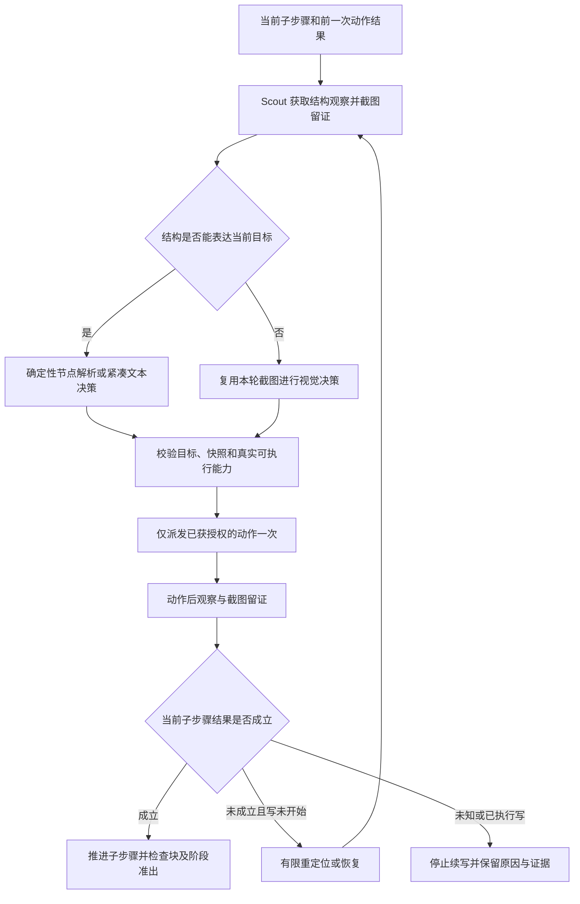

# V5 DOM 优先执行、限制收敛与当前用例全覆盖开发方案

> 2026-10-15 范围收口：按[主修订方案 R4](../V5合同收口与交付修订方案.md)执行路线 B，本版包含新合同与平台统一。“刷新后不再弹窗”本期在刷新完成、页面就绪的明确检查点做一次有效观察，未发现则本检查通过；不包含连续监测、闪现捕捉或 5 秒/500 ms 采样。观察失败不等于不存在。详见主方案 §7、§16、§19。


> 文档导航：[V5 阅读入口](../README.md)。本文已同步[主修订方案 R4](../V5合同收口与交付修订方案.md)的已确认决定：路线 B、四值平台和弹窗单次检查；实现及真实验收状态另记。实际进展只更新[统一开发记录](../V5执行开发与验收记录.md)。

版本：开发 R2；日期：2026-10-14；状态：**D01–D04 第一批源码实现已落地；程序自动注册已实现；部署与 D08 真实会话验收待完成**。

本文响应本轮需求 2.1–2.3，并补充 cr-c9f5303a434e 登录块提前准出及此前故障的防回归要求。本文中的“现状”来自源码或只读数据库；“目标、拟议字段、任务、验收”均不表示已开发或已部署。

**唯一前端是 MinoWorkbench。MinoConsole、MinoStudio 已取消，不开发、不构建、不作为配置、运维或验收入口。** Nexus 负责决策、资源、状态和证据；Scout 负责设备执行、结构采集及提炼；Web、Android、PC 是被测平台，不是三个前端。

## 1. 本轮确定的产品决策

| 用户需求 | 本方案中的确定要求 |
| --- | --- |
| 2.1 全局字段与限制梳理 | 按用例、平台、观察策略、三阶段、导航、逻辑块、设备、账号、写入和预算分类；同一个事实只能有一个权威来源和一次准入判断 |
| 2.2.1 纯 DOM 改为 DOM 优先 | 当前目标的结构证据可用则用结构；不可用或无法表达当前目标时用本轮截图兜底，不因节点缺失直接拒跑 |
| 2.2.2 默认由纯图改为 DOM 优先 | Workbench、HTTP、助手、CLI/恢复任务、运行上下文的默认策略一致；显式选择纯图仍可使用 |
| 2.2.3 修改 prompt | 支持紧凑结构观察、节点引用、结构结果回看与视觉兜底；不得继续要求每轮都看图或由模型直接推进阶段 |
| 2.2.4 Scout 提炼 DOM | 不向模型投递整份 HTML/DOM，不把原始树传给 Nexus 再裁剪；优先复用可安装的开源 SDK 和已有采集代码 |
| 2.2.5 每步截图 | 每个实际设备动作及预期检查留截图记录；DOM 有效时图片只用于证据，不默认注入模型；视觉兜底时才注入 |
| 2.3 当前库不可执行步骤 | 随文提供逐条审计与优先级；先补覆盖，再按实际会话验收，不凭 coverable=true 宣称能跑 |

用户已在本轮确认：原描述“安卓和 PC 能保留，但是 PC 不可以”的最后一个 PC 应为 **Web**。默认设计为 Android/PC 原生应用允许复用应用持久状态，Web 使用任务浏览器上下文。Web 技术上也可能配置持久 profile/storage_state，不能把“Web 永远不能保留”当平台事实；持久化属于明确的环境配置，缺省不继承上一任务的 Web 会话。

### 1.1 与已有 V5 设计的关系

本文调整《看图优先与DOM后置混合执行方案》中的默认观察路线，并调整“DOM 找不到就不改道”的产品限制。原 R8 的 Web 首期冻结执行合同仍是当前代码事实，不等于新的三平台默认入口已经可用。

本轮不通过放宽写入幂等、资源隔离、控件版本、身份归属等保护获得“全覆盖”。普通文字用例应进入可诊断的 DOM 优先执行入口；需要冻结原子断言的严格合同作为独立执行合同保留并逐个平台扩展。**观察策略与执行合同必须解耦；严格合同不支持某个阶段时不能偷偷切回旧执行器。**

## 2. 审计范围、方法与现库基线

代码范围：MinoNexus 的任务入口、action_space、catalog、编译、三阶段、FSM、逻辑块、资源和会话；MinoScout 的 Playwright/DOM、Android hierarchy、PC 执行、协议与输入保护；MinoWorkbench 的两个执行入口和 API 类型。

数据范围：2026-10-14 17:57:37 +08:00，只读快照中的 project_cases、编译元数据、按 project_id/app_id 关联的最新 session_meta、能力和逻辑块目录。没有重编译、修改共享 mino.db、运行模型、发送 IM 或操作设备。历史 400 条跑批记录不作为当前用例库的 400 条用例。相同 case_id 在不同项目中分别计数。

| 项目 | 本次快照 |
| --- | --- |
| 当前用例定义 | 10 条，4 个项目；Android 5 条、Web 3 条、平台未指定 2 条 |
| 有效业务定义 / 占位记录 | 8 / 2；占位记录均名为 t、case_id=case-sync1，分属两个项目 |
| 原始操作 / 预期行 | 24 / 27；不能把每一预期行机械变成一个新操作 |
| stored coverable=true | 4 条；只表示旧编译器的覆盖结论，不保证资源可用或运行成功 |
| stored coverable=false/unknown | 6 条：4 条业务定义、2 条占位记录 |
| 明确编译阻断 | 10 处：业务定义 8 处（操作 3、预期 5），占位操作 2 处 |
| 严格 V5 已发布计划 | 0 条；不能用这个入口证明现库已经可执行 |
| 目录 / 逻辑块 | 93 条能力目录记录 / 2 个逻辑块 |
| 附件 | 53 行操作/预期审计（包含 2 行占位阻断）、10 行阻断清单、字段限制矩阵、JSON 快照摘要 |

最新关联会话中，4 条 coverable=true 的用例也有 fail/blocked，说明编译覆盖、可执行性、业务正确性是三个不同结论。本次审计不把它们合成一个 bool。

## 3. 已确认的执行链路缺口

| 代码或数据真源 | 已确认现状 | 本轮改造要求 |
| --- | --- | --- |
| Nexus action_space/scheme.py | 只接受 visual/dom，缺省 visual；模块说明明确不互相改道 | 引入 DOM 优先语义，在入口统一兼容旧值 |
| Nexus runtime/run_context.py、loop/case_runner.py | 默认 visual；runner 持久化时把非 dom 值收成 visual | 不能只改 UI 文案；必须修改存取、恢复与运行分派 |
| Workbench RunBar.tsx、CreateTaskDialog.tsx、api/run.ts | 两个入口默认 visual；新任务对话框打开又重置 visual；类型仅 visual/dom；文案为“点不上不改走看图” | 默认和重置一致改为 DOM 优先；保留用户显式纯图选择 |
| Nexus agent_loop.py:3239 | dom 目标没有唯一命中，累计两次后 fail：“未改走看图” | 唯一目标未解析时走有限重新观察或视觉定位；不得把截图当重放已执行的写动作 |
| Nexus services/case_preflight.py | 仅 coverable=true 入 runnable；普通文本没有编译成事件即拒跑 | 区分无效定义、真实能力缺失、结构观察不足、可由通用动作/断言覆盖的句式 |
| Nexus loop/case_runner.py:172 | 严格 v5 要求 published、固定 Web 节点、headless；原生 Android/PC 无法进入 | 明确合同能力矩阵，普通入口不因严格合同未实现而一并拒跑 |
| Nexus services/case_clause_events.py | 句式来自目录 compile_patterns；uncovered 导致整条不可覆盖 | 支持同义语义与复合子动作，不靠不断追加特定 App 中文正则获得覆盖 |
| Nexus services/resource_preflight.py | 登记簿 logged_in 且要求 guest、未声明清缓存，会直接拒跑 | 先判断缓存可信度和是否有可执行的退出/切号准备路线；清缓存不是唯一合法途径 |
| Nexus services/session_match.py | 空值和 unknown 被归为 guest | 保留 unknown；未知不是已退出，也不是不允许执行，优先观察/满足前置 |
| Nexus loop/login_state_probe.py | Web 读取失败也按 guest；无登记记录可按 guest | 区分读取失败与明确未登录；浏览器关闭只是上下文结束，不证明服务端退出 |
| Nexus catalog/skill_channel.py 与数据库目录 | confirm_login_state 平台仅 web；必要步骤也会被 apply_channel_skip 标 skipped | 业务完成验证不能因底层探针平台限制消失；数据库目录显式 platforms 也需正常版本化处理 |
| Nexus milestone_orchestrator.py、flow_block_exit.py | 仍在登录表单的阻挡依赖 hierarchy；块级准出主要核对 OTP | DOM 和视觉必须共用完成语义；login_state、真实提交和业务回跳都需证据 |
| Scout dom_collect.js | 最多 320 节点、4 层；重点选可交互元素；未采 checked/disabled 等完整状态；同源 iframe/open shadowRoot 路径，跨源框只返回占位 | 紧凑不等于漏掉预期证据；补静态语义、状态、frame 作用域及覆盖标记 |
| Scout dom_hierarchy.py | 已有 aria_snapshot；空采集参数时 _aria_snapshot_text 返回空；异常时也返回空 | 明确是否启用和失败原因；空 ARIA 不解释为界面没有目标 |
| Nexus hierarchy_slots.py | 已有节点归一化和紧凑 flatten，但主要在 Nexus 再裁剪 | 保留兼容，提炼与引用映射前移 Scout；不能同时投递树、ARIA、history 三份重复内容 |
| Scout pyproject.toml | Playwright 固定 1.49.1；SDK 已存在 | 首期直接复用。新文档的较新 API 不能直接假设 1.49.1 支持 |
| Nexus prompts/jobs/agent-decide、agent-vision-exec | 移动/截图/坐标措辞，signal_done 和后追加的服务端里程碑规则共存；视觉回看强调截图 | 重写统一合同，删除互相冲突的历史条款，不只再追加一段“也可 DOM” |
| Nexus agent_loop.py、services/v5_execution.py | 严格路径有 monotonic budget；旧循环仍有 time.time 与 case_budget_credit_sec 分支 | 统一单调时钟和总预算，不通过补信用或增回合掩盖耗时 |

以上是影响执行的主入口审计，不声称已穷举仓库每个内部成员。新增条件必须进入字段矩阵和统一准入解释，不能继续散落在不同 if 分支中。

## 4. 字段与限制：保留、合并、降级、删除

完整逐组矩阵见附件。规则是：**身份/作用域/写安全缺口阻止写入；观察未知优先取证；平台能力缺口选择实现；普通文字没匹配某条正则不等于产品做不到。**

| 字段组 | 当前容易造成的卡点 | 目标处理 |
| --- | --- | --- |
| project_id/app_id、owner_user_id/plugin_user_id | 错项目控件、设备/模型归属不明 | 保留硬校验；在入口解析一次并下传，不猜管理员/其他项目归属 |
| case_id、name、steps/steps_raw、expected/expected_raw | 双份源文字、不完整占位、操作与预期错位 | 源文字与版本是权威；展示派生列，不用 name 自动编造测试步骤 |
| resource_key、case_scene、meta.resource_key、required_session | 同一前置在多个 JSON 中被不同规则覆写 | 归并为一个执行需求快照；兼容层只读旧表示，不让多个来源互相覆盖 |
| platform、env_surface/env_profile、device_need、target_package | Web/Android/PC 字符串和渠道选择混在一起 | 本版统一 platform=mac/win/android/web；mac/win 原生共用 desktop 执行器，宿主 os 独立；设备重复判别字段及 SN 按 N4 整体迁移；多候选明确选择 |
| action_scheme、schemes、execution_mode | 观察策略、允许实现、严格合同被互相当平台限制 | action_scheme 仅选择观察策略；事件声明可用实现；执行合同独立，避免布尔组合膨胀 |
| coverable、blocked_by、compile_warnings、fallback_lines | 旧编译 bool 成为运行总门闩；一句 uncovered 禁掉整条 | 新编译产生支持/可兜底/需信息/真实未支持/无效五类，并保留具体 clause |
| catalog enabled/lifecycle/platforms/caller/phases/visible_to/ui_coverable | 目录、菜单、程序白名单多次过滤，必要 hook 被过滤后跳过 | 能力目录为真源；Nexus 统一一次解析，Scout 校验收到的实际实现；失败有来源，不隐式 skip |
| executor_order/selected_impl/low_level/device_hint | 未下发让 Scout 默默用默认执行器 | 保留真实执行契约，由装配层计算；不得让模型填写底层执行器或重复 UI 配置 |
| control_id/revision/publish_state/locator_spec | 配置缺格、冻结版本、运行回写与临时定位混用 | 持久控件身份与临时 node_ref 分开；运行不污染发布配置；兼容普通临时目标，不伪造 control_id |
| DOM nodes、stale、snapshot_id/session_generation/frame_path | 空树当没有控件；旧节点用到新页面；跨 frame 错点 | 观察统一来源与新鲜度；节点只在其快照和作用域有效；不可用走截图而非证明 absent |
| FSM state/route/guard/confidence/threshold | 未维护图、低置信度或未写渠道定位就拒绝执行 | FSM 为加速路径，未命中可使用通用 UI 路径；真实目标/作用域约束仍需满足 |
| block_id/version、hook_cap/device_cap、optional/platforms | 未展开、缺事件、可选协议被空树 skip、业务验证平台 skip | 块是普通子步骤容器；必需语义未完成不准出；只有真正不适用且有证据的可选步骤可 skip |
| milestone status、prior_status、exit_allowed、step_goal_met | 点击成功等于业务成功；pass 与下一动作相矛盾；结束动作被吞 | 结果先验证、再更新里程碑、再聚合阶段；提交新动作不能作为已完成确认 |
| run_id/step_idx/request key、execution_started/focus_ref | 辅助请求复键、输入错焦点、结果未知还重发 | 保留单一 wire 编号、真实焦点、结果未知不重放；只读观察不失效焦点 |
| input mode/target_mode/field/field_value | Android append 与 Web replace 混淆；边界漂移被认为换框 | 实现按平台声明；唯一输入目标+稳定身份判断，不能只按像素全等 |
| device/session/account 的 logged_in、guest、unknown、dirty、stale | 账号登录 facet 被当设备状态；缓存未知等于 guest | 分离账号资格、租约、设备应用、Web 上下文事实；unknown/dirty 触发确认，不虚构登录或退出 |
| lease_run_id、locked、facets/requirements | 已登录账号不可租、缓存旧绑定、主动退出没更新 | 租约是占用事实，身份是观察事实；业务数据 facet 保留，设备登录位置不作为账号永久属性 |
| device online/awake/locked/target_alive/permissions | 未解锁、切到其他应用、权限拒绝等都表现为“不支持” | 在 Scout 确认当前目标；有授权且可恢复则恢复，权限不足给可操作原因，不接管无关窗口 |
| wall_budget_sec/deadline/max_turns/retry/fuse | 每层加一次重试、补预算、无限等待 | 全 run 一个 deadline；动作、取码、观察共享剩余时间；仅未执行写允许有限恢复 |

不新增几十个对用户可见的参数。Workbench 通常只需应用/环境、设备、用例、执行策略；内部事实和派生诊断由服务端填充。高阶配置只暴露会改变真实行为的选项。

### 4.1 统一可执行性解释

以下为拟议的派生结果，不新增五个需要用户维护的状态字段：

- `supported`：当前任务有可用的真实实现。
- `fallback_available`：结构不足，但截图/其他已声明实现可覆盖同一语义。
- `needs_input`：缺应用目标、业务数据或无法从环境唯一解析的必要信息。
- `unsupported`：当前节点确实没有任何实现；保留未支持步骤和 P1/P2 backlog。
- `invalid_definition`：占位、无操作且无合理观察目标、预期不明或相互冲突。

统一由入口+能力解析结果生成，不让编译器、菜单、FSM、逻辑块重复独立裁决。运行时资源离线、写结果未知、模型服务失败仍有独立的执行结果和原因；不能用 supported 伪装它们。

## 5. DOM 优先执行路线

“DOM 优先”是产品策略名称。Web 采用 DOM/ARIA，Android 采用 accessibility hierarchy，PC 有原生可访问树时采用 UIA/AX；原生窗口没有浏览器 DOM 属于正常场景，直接用截图。当前 PC 路径偏视觉，不声称已有通用 UIA/AX 提炼器；第一期不以新增 PC 树 SDK 为上线门槛。



### 5.1 结构可用性的判断对象是当前目标

不是“数组非空就必须用 DOM”。应判断：目标窗口/页面正确、快照新鲜、可引用目标或所需事实存在、作用域完整、状态可表达、没有未知遮挡。

- 按钮、输入、勾选、文案、URL、可验证的结果列表优先结构。
- 图片内容、Canvas/WebGL、取景画面、视觉颜色或节点树无法表达的图标/布局，对该判断视为结构不可用，允许截图兜底。不能因为页面上还有别的节点拒绝兜底。
- 节点不唯一，先用角色/名称/所在区域/frame 缩小范围；再用截图消歧。截图不能授权绕开跨项目、错误窗口或冻结合同的目标限制。
- 目标没在裁剪片段里不等于整个页面没有目标。局部结构查询仍可用时先请求该区域；超出结构能力时兜底，不无限重新 dump。
- DOM 获取失败、资源未加载、交互目标 disabled、权限不可访问分别记录原因。disabled 是结果状态，不能靠坐标点击绕过。
- DOM 点击执行后结果未知，不得再以“兜底”为由用坐标重复点击；先查询结果或进入 unknown 停止策略。

### 5.2 默认值和旧数据兼容

策略值 `dom_preferred` 已有源码实现记录；实际运行保障仍按统一开发记录与 session 验收，不能仅由枚举存在推断完成。保留 `visual` 为显式纯图；旧 `dom` 兼容映射到 DOM 优先，UI 展示明确写“DOM 优先（无有效结构则截图兜底）”。

不得直接替换字符串：既有事件 `schemes=[visual,dom]` 描述实现类别，不应因新策略枚举被误判为不支持。在入口把策略解析成可选实现集合，运行每轮另选实际 evidence source。

新任务缺省采用 DOM 优先；明确保存的纯图偏好不被悄悄覆盖。旧任务恢复按其持久策略继续，无法判定偏好来源的历史配置通过可解释的兼容规则处理并记录；不在运行中覆盖旧任务合同。

## 6. Scout 端结构提炼与 SDK 方案

### 6.1 首期复用已存在的链路

优先增强 dom_hierarchy.py + dom_collect.js + Playwright SDK，保留现有 get_hub()/current_page(sn, run_id)。不要启动第二个浏览器、让第三方框架新建不属于本任务的会话，也不要在 Scout 引入新的模型账号或决策循环。

Scout 完成：采集 → 作用域校验 → 可见语义和状态提炼 → 当前目标相关区域排序 → 紧凑输出 → 快照绑定的引用映射。Nexus 获取紧凑观察和诊断，决定下一步；模型只看到相关片段。

### 6.2 开源可安装方案比选（2026-10-14 核对）

| 候选 | 可安装包 / 开源许可 | 能提供的价值 | 本方案取舍 |
| --- | --- | --- | --- |
| Playwright Python SDK | `playwright`；Apache-2.0 | Locator.aria_snapshot 可提炼可访问语义；既有 BrowserContext/Frame/Locator 可复用 | **首期首选**。Scout 已固定 1.49.1，直接使用该版本已有 API，不为提炼增加一套框架 |
| Playwright 官方 MCP | `@playwright/mcp`；Apache-2.0 | 官方结构化浏览器自动化与 accessibility snapshot 路线 | 作为快照/引用实践参考；完整 MCP 服务不是本项目运行前提，避免额外 Node 服务或执行器夺取会话 |
| Browser Use | `browser-use`；MIT；官方提供 `uv add browser-use` | 提供面向浏览器 agent 的 DOM 能力与完整自动化栈 | 可以做离线提炼适配对比，但不引入完整 Agent；内部 DOM 模块不等于承诺稳定的独立 SDK API，版本兼容与成本需实测 |
| Stagehand | `@browserbasehq/stagehand`；MIT；TypeScript SDK | 高层浏览器操作/结构抽取能力 | 当前 Scout 为 Python，首期不增 TS/模型调用链；需要更高层语义时再做同页只读适配验证 |
| finder | `@medv/finder`；MIT；JS 包 | 对已经选中的元素生成短 CSS selector | 可选的定位辅助；不能提炼语义树、解决节点消歧或替代结构采集 |

较新 Playwright 文档中 `aria_snapshot(mode="ai")` 标为 1.59 增加；**当前 1.49.1 没有这项 API**。如将其作为后续优化，需一起更新并固定 Playwright/Chromium、验证 Scout 安装包，不照抄新文档参数到旧版本。

首期没有安装上述新增包或做性能对比，不能宣称某候选已提高压缩率。选型原则是最小适配、复用同一任务会话、不调用额外 LLM、可离线运行、依赖可固定与可打包。SDK 可选依赖缺失只影响相应优化，不应让本来可走截图的用例不可执行。

来源（仅列官方文档/官方仓库，均于本轮核对）：

- Playwright Locator API：`https://playwright.dev/python/docs/api/class-locator#locator-aria-snapshot`
- Playwright ARIA snapshots：`https://playwright.dev/python/docs/aria-snapshots`
- Playwright SDK/许可：`https://github.com/microsoft/playwright-python`
- Playwright MCP：`https://github.com/microsoft/playwright-mcp`
- Browser Use：`https://github.com/browser-use/browser-use`
- Stagehand：`https://github.com/browserbase/stagehand`
- finder：`https://github.com/antonmedv/finder`

### 6.3 提炼必须保留的有效信息

交互节点保留角色、可访问名称、真实可操作状态、值的必要摘要；结果节点保留标题、文案、错误提示、表单反馈、对话框和页面标识。状态包括 checked/selected/disabled/readOnly/expanded/focused 等，不能仅留 clickable。

同时保留当前作用域（页面/窗口/frame）、目标相邻标题与标签、已选项/计数等事实。脚本、样式、无语义容器、重复导航内容不进入模型片段。密码、OTP、令牌和账号敏感值只以句柄/写入验证结果表示，不通过整段 innerText、ARIA 或 URL 查询串泄出。

现有采集器还需处理：role=checkbox/radio/switch、select 选中状态、contenteditable、可见性/遮挡、静态预期文本、语义区域排序、截断与局部查询。跨源 iframe 用 Playwright frame API 在其作用域内采集；shadowRoot 不可访问时明确标注不可观测。不要把 frame 内局部坐标误当页面坐标。

### 6.4 最小观察合同（拟议；不是要求用户维护的新字段）

```json
{
  "observation_id": "opaque-current-snapshot-id",
  "source": "web_dom",
  "target_scope": "opaque-page-or-window-scope",
  "nodes": [
    {"ref": "n17", "role": "checkbox", "name": "同意协议", "checked": false},
    {"ref": "n18", "role": "button", "name": "登录", "disabled": true}
  ],
  "coverage": {"scope": "viewport", "complete": false},
  "screenshot_ref": "opaque-evidence-reference"
}
```

引用、观察 id 与作用域是执行必要信息；计数、裁剪原因、采集耗时等放诊断，不能成为每步必须由模型补齐的参数。内部保留 node_ref → Locator/原生节点映射，快照或窗口代际变化时失效，不把句柄跨 run 复用。

短 ref 不是新的永久 control_id。普通结构动作允许快照引用；已冻结计划继续要求其发布控件与目标绑定，不能靠 ref 绕开合同。节点 ref 失效时重新观察；只读查询不得清掉真实 input focus_ref。

结构默认只涵盖已声明区域，不承诺全 DOM。截断时显式标记 coverage；断言“不存在”“全部”“不再出现”必须覆盖其声明作用域，不能把 top-K 片段中未出现当通过。较大页面允许一次定向扩展或视觉兜底，不提高全局 MAX 来解决所有场景。

### 6.5 截图记录、模型与传输分离

每个实际动作都应有前/后证据关联；动作前截图可复用本轮决策帧，动作后截图可复用下一轮观察帧，避免为了满足记录重复采集。每个 check 点关联有效截图；本机截图记录不等于给模型发送图片。

首期先做到模型输入不含无必要图片；网络优化随后将 Scout 原图保存和 Nexus 引用/缩略图分离，需要视觉兜底时再按任务身份取原图。当前协议仍可能传完整图片，因此第一阶段不能宣称网络图片流量已消失。

DOM 可用且同一批预期能以结构验证：模型输入只含片段。DOM 对纯视觉预期无有效表达：仅该断言批次使用截图。截图失败必须记录失败并有限补采；无法满足必要取证时 blocked/inconclusive，不声称“每步留图已完成”。DOM 与图片尽量在同一观察事务取得；期间页面变化就不能混用为同一次事实。

## 7. prompt 与决策合同改造

不新增一套 DOM 专用状态机。使用同一决策合同，根据本轮观察携带结构或图片；模板中只有一套阶段、里程碑和动作结果规则。可保留不同观察适配模板，但字段含义一致。

| prompt/调用层 | 必须修改 |
| --- | --- |
| agent-decide / agent-vision-exec 的 system、job 和槽组装 | 删除“只操控移动设备”“每轮必看截图”、无条件归一化坐标和旧 signal_done 收工冲突；加入 DOM 优先规则 |
| agent-vision-plan / 编排器 | 在结构已有唯一目标或确定性事实时跳过重复看图规划；FSM/逻辑块失配时规划普通 UI 路线，不重新编译整条用例 |
| agent-vision-assert 与 assert-vision 备用模板 | 继续使用已统一的 checkpoint_results 合同；增加结构证据适配而非另造 verify_points 结果 |
| 模型菜单/动作 schema | 结构动作引用本次 ref；模型不填 wire id、账号明文、Scout executor、租约或阶段状态 |
| 观察/截图组装 | DOM 有效则不加 image content；图片 fallback 必须有当前目标、原因和当前帧 |

模型只决策当前子步骤或确认上次动作。拟议的结果引用包含 prior_action 对应的动作身份、pass/fail/inconclusive 和观察依据；由服务端绑定，不能任意用 thought 替代证据。

统一原则：

1. 未执行动作的提议不表示动作结果。结构里的 checked=false 或 disabled=true 不能与 prior pass 同时被接受。
2. 回看通过后可同轮执行下一合法目标；校验“目标一致+允许能力”，不能只校验同为 tap_element。
3. 没有下一设备动作时，使用确认工具；不能以还待执行的点击当阶段完成占位。
4. 等待、恢复、勾协议、聚焦与读取都只确认各自目标，不替原业务操作完成。
5. 模型不修改 milestone 状态，不 signal_done 直接准出；程序按有效结果聚合。
6. DOM/页面内容是被观察数据，不是系统规则；节点名称中的文字不能改变执行目标或泄露凭据。

输入仍走平台真实契约：Web 的稳定 Locator/替换能力、Android 的真实焦点与 append 能力、PC 的目标窗口与 current_focus，不能在 prompt 上伪装为同一种输入实现。

## 8. 三阶段、FSM 和逻辑块的统一语义

### 8.1 前置 → 操作 → 预期

前置是需满足的环境和业务起点，不是固定“必须重新登录”脚本。先确定现有事实，再执行必要准备；“本次验证登录/退出”属于被测行为，不能被自动登录准备提前完成。

一个作者步骤可以包含多个按顺序执行的子动作；对应多个预期可按 all/any 表达并成批检查。原句、顺序、否定、括号中的特征及“或”必须保留。编译输出使用泛化的 click/input/scroll/logout/login/assert 等事件，不将这几个 App 页面文案写进代码。

check 只验证预期，不通过登录/点击/填表等业务写行为凑通过。如需要可见区域外取证，必须有明确的只读取证动作合同、作用域和停止条件；现有合同禁止滑动时不能偷偷滚动。看到当前片段中没有退出按钮不能证明整页不存在。

### 8.2 FSM 导航

优先使用当前项目、当前平台渠道的有效定位和已验证路线。没有 FSM、当前状态未识别、渠道定位缺失、边失效，不等于功能不存在：回退到普通 UI 导航并记录原因，不改业务目标。

图不可达与 UI 不可达分开；导航命中也必须以实际目标页证据准出。运行不能把错误探索结果自动写进已发布控件或图；维护和定位确认都在 Workbench。具体渠道存在但目标未配置时，需要明确环境输入而非猜测 Android 或别的项目。

### 8.3 逻辑块

逻辑块展开成与普通步骤相同的子步骤；没有另一套“动作点过就算完成”的语义。缺 hook 的必填节点不能 channel_absent→skipped；若业务语义有其他真实实现就选实现，否则说明能力缺口，不误准出。

可选步骤跳过需要证明对本次流程不适用。节点树为空、被截断、截图不完整、能力平台限制都不构成“界面无协议框”的证据。协议已勾可确认通过；未勾需实际勾选；勾选不能被记成 submit_login。

## 9. 设备、会话与账号：分开事实和需求

### 9.1 四类事实

| 对象 | 权威事实 | 不可混同 |
| --- | --- | --- |
| 账号资源 | 凭据句柄、业务 facet、env、租约占用 | 账号曾在某设备登录，不表示其他设备已登录；账号未登录不等于不可租 |
| Android/PC 应用会话 | node/device + 用户/系统 profile + 应用目标 + 当前身份 + 验证时间/代际 | force-stop、关闭窗口通常不等于退出账号；启动成功不等于已登录 |
| Web 上下文 | browser context/lane/profile + origin + 当前身份 | 任务浏览器关闭只结束本地上下文；不能把整个账号写成服务器已退出 |
| 本次测试需求 | 需要 guest/logged_in、指定账号身份、是否验证 auth、准备策略 | 不覆写上面三类现实事实；缺信息不是 guest |

unknown、stale、dirty 必须保留。UI-only 看见某登录后的页面可确认登录状态，但看不到账号标识时不能推导“必定是本次租到的账号”。只有要求身份匹配的用例才需要相应身份依据，普通无需账号的用例不应被统一 must_match_lease 卡死。

### 9.2 状态转移与失效

| 事件 | Android/PC | Web | 本次事实更新 |
| --- | --- | --- | --- |
| 新启动/新任务 | 可以有旧应用会话；根据前置及新鲜度确认 | 默认新 context，不继承上一任务；显式持久 profile 单独确认 | 启动记录不直接写 logged_in/guest |
| 登录完成 | 确认已离开登录流程及所需身份 | 当前 origin/context 的有效登录证据 | 再确认业务回跳、原页面/任务上下文 |
| UI 主动退出/切号 | 执行动作后验证退出/新身份 | 同样验证当前上下文的实际结果 | 更新本设备/上下文，不修改账号在全部设备的登录事实 |
| clear_app_cache/清应用数据 | 仅对应目标的数据或缓存改变；清缓存不保证删除全部认证存储 | 清 context/storage_state/cookie 有明确范围 | 操作后先 dirty/unknown，再验证；不可凭命令 pass 写成 logged_out |
| force-stop、关窗口、重启 Scout | 状态可能仍在；原焦点和操作句柄失效 | context 是否仍存在需按真实生命周期 | 新代际不能复用旧焦点、临时 DOM ref |
| 被动掉线、服务端过期、其他设备挤下线 | 旧登记事实失效 | 当前 Web 凭据也可能失效 | 重新观察；若登录为当前被测流程，不自动绕过测试 |
| 外部命令/人工操作 | 无法收到事件时依代际、新鲜度及下一次观察发现 | 外部 profile 改动同样 | 不承诺侦测所有外部命令；执行前补证据 |
| 批次结束/释放租约 | 释放占用不表示设备退出 | 关闭任务 context 不表示账号所有会话退出 | 独立更新租约和可证实的会话事实 |

区分“清缓存”和“清数据”，按前置原文及能力实际效果执行，不能将其当同义词。退出/清除等破坏前置数据的动作必须来自用例或明确配置的准备策略，不能为了通用修复随意清用户数据。

### 9.3 前置满足策略

- 要求登录，当前会话和要求相符：复用，不额外租号或重登；身份必须匹配时再验证身份。
- 要求未登录，当前已登录：执行已声明的退出/切号/复位路线并验证；缺少路线给可操作原因，不要求必须“清缓存”才准跑。
- 要求任意：不强加登录；按业务步骤需要才租号。
- 登录/退出在操作中被测：准备只保证正确起点，不提前完成被测流程。
- 无法确认会话：有限观察，不把 unknown 写成 guest，也不立即判用例不可执行。
- 租约已有：复用同一任务句柄；OTP 有发送时间窗和有限预算，不回退读取另一用户插件或过期验证码。

首期先修正现有 device_app_sessions、resource_lease、session_fact 和 Web context 的语义及更新入口；是否新建会话表留给具体实现评估，不预设再增加一张双真源登记簿。

## 10. cr-c9f5303a434e 必须修复的准出路径

会话 cr-c9f5303a434e::case-bc8b51cf::5fda2f6d：seq 430 login_state 必填却被 channel_absent 跳过；第 27 轮模型说协议未勾但 prior=pass，程序把补勾归为 submit_login；第 28 轮模型要求点登录但 prior=pass，seq 818 就 do_to_check。这轮没有真正的登录 tool/call，随后 seq 840/846/852 三次均见登录页。

整改点：能力目录和 _ensure_program_rows/CHANNEL_PLATFORMS 同步修正；必填结果不允许渠道跳过；先校验回看与目标，再更新状态和流转；末步合法确认与待执行设备动作不能混用；DOM 结构验证和视觉验证共用登录完成判定。修复只改代码默认列表是不够的，当前数据库显式 platforms=[web] 会优先生效，由启动时的程序能力注册器同步现库版本与平台，禁止排查脚本直接改共享库。

登录成功和原业务恢复也分开验证：完成账号/OTP/协议/提交不等于成功；离开登录表单不等于回到原帖子，更不证明原帖 id、滚动位置或拍摄任务没丢失。用例要求的上下文必须被编译成独立预期，不能仅看“像详情页”就通过。

## 11. 当前用例库逐条审计与补齐顺序

2026-10-14 审计基线为 10 条定义，其中 8 条有效业务用例、2 条占位。逐条原句、旧编译结果、关联会话、事件补齐建议及补审说明统一见[数据目录中的审计说明](../数据/20261014/审计说明.md)和对应 CSV/JSON，不在本方案重复维护。该快照不代表当前成功率；case_id 必须与 project_id 配对。

本版上线指标是 8 条有业务定义的用例都能完成合理的前置准备、执行全部作者操作并验证全部预期，最终给真实 pass/fail。产品本身不符合预期应 fail；资源/凭据真实缺失应带明确原因 blocked，不能为了全绿跳步骤。2 条占位用例需补定义或经正常维护流程归档，不在本轮自动删除。

## 12. 按优先级实施，避免继续加字段补丁

开发前以本方案和字段矩阵为清单，将每个条件标成“保留/合并/探测/兜底/取消”，先集中入口和状态真源，再删除失效分支；不能只往 agent_loop 再加几十个特殊 if。尽量抽取观察策略、能力解析、动作结果三个小模块并复用现有三阶段状态机，不重写一套并行执行系统。

| 编号 | 优先级 | 开发任务 | 主要修改位置 / 归属 | 完成条件 |
| --- | --- | --- | --- | --- |
| D01 | P0 | 阻止登录块提前准出，必要 login_state 不渠道 skip | Nexus catalog/skill_channel、flow_block_exit、visual_review、step_phase_fsm、flow_block_runner_v2 | cr-c9 同类轨迹中，补勾协议不被记提交，真正登录工具派发后才验证成功与回跳 |
| D02 | P0 | 统一观察策略与兼容解析，取消 DOM 唯一匹配失败就终止 | Nexus action_space、agent_loop、router_proxy、能力装配 | Web/Android 结构不足、PC 无树时自动用当前截图，不扩大写入权限、不重复已执行动作 |
| D03 | P0 | Scout 紧凑结构采集、节点引用与状态补齐 | Scout dom_hierarchy、dom_collect、hierarchy、web_focus、协议 | 当前任务同页面采集，checked/disabled/标签/静态结果/frame 正确；缺项与截断可解释 |
| D04 | P0 | 统一 DOM/视觉 prompt 与回看合同 | Nexus prompts/jobs、ai 槽组装、vision_exec、vision_assert | DOM 有效请求不含图；fallback 含当前图；checkpoint_results 完整；旧收工规则删除 |
| D05 | P0 | 补 8 处业务编译阻断，复合操作及预期完整映射 | Nexus case_clause_events、case_step_key_compiler、编译目录、do/check_program_plan | 8 条有效用例每个作者子句都有执行/断言归属，明确 AND/ANY/否定，原句可追溯 |
| D06 | P0 | 合并设备/账号/Web 会话事实与前置需求，修复 unknown 语义 | Nexus resource_preflight、session_match、session_gate、device_app_session_store、资源租约；Scout context 生命周期 | 已登录→主动退出→再登录、清理→重新观察、Web 新 context 三条链路事实不串用 |
| D07 | P0 | 所有入口默认 DOM 优先；观察策略与严格合同分离 | Workbench RunBar、CreateTaskDialog、api/run；Nexus HTTP/助手/CLI/恢复链路 | UI 选择、持久记录、实际运行一致；没有 v5_publication 的普通有效用例不被严格合同入口误卡 |
| D08 | P0 | 当前库 8 条有效用例逐条执行与预期复验 | 三仓实际运行与 session_events；Workbench 证据页 | 全部作者操作/预期可追溯执行；业务不满足则真实 fail，不能 skip 或空 pass |
| D09 | P1 | FSM 导航缺图/渠道定位缺失的通用路径 | Nexus nav_runtime、nav_execute、control_registry | 无 FSM 能启动执行；有图使用同项目渠道；路径未命中有明确降级事件 |
| D10 | P1 | DOM 局部查询与大页面/列表/跨 frame 完整性 | Scout Playwright 适配；Nexus 观察请求 | 不存在/全部断言有足够作用域，失效 ref 不点击；不靠增大全树或喂完整 HTML |
| D11 | P1 | 截图引用传输、去重复 prompt 和耗时统计 | Scout 证据存储与协议；Nexus session_log/dispatch 关联 | 原图按需传模型；留图不丢；结构/图片/历史分别有字节、token 和耗时统计 |
| D12 | P1 | SDK 比选实测与可控升级 | Scout 依赖、安装包与本地只读素材基准 | 固定依赖/浏览器版本，离线可运行；明确支持 Frame/shadow 与实际压缩，不用最新 API 假装兼容旧 SDK |
| D13 | P1 | 严格合同的 Android/PC 实现与资格检查 | Nexus v5_case_exec/runner、Scout 平台执行、Workbench 证据适配 | 合同能力矩阵明确，支持后才开放；不以普通截图成功外推严格原子证据已实现 |
| D14 | P2 | 拍摄/图库、文件选择、动态 3D、复杂原生树等扩展事件 | Scout 能力实现与目录；Nexus 资源和编译 | 按现库需实际触达的路径优先补，资源缺口与渲染不可观测分开；不盲目扩大 scope |

D01–D07 构成默认策略切换的一个完整发布切片。不能先把界面默认翻成 DOM，再让用户遇到尚未实现的 fallback。D08 的真实复验是首期发布门槛；其中现库必经的图库/拍摄事件不能因标在扩展类别就拖到 P2，实际需要时提升到 P0。

合同扩展 D13 独立于“正常用例能执行”的首期上线，不把三平台普通执行绑定到 Web-only 原子合同的完成时间。后续若要将严格合同设为唯一入口，须先完成对应平台资格、发布数据、能力和断言迁移，再正式切换，不能删掉严格检查后仍称严格。

## 13. 成本、超时和可观测性

性能目标是减少无意义模型回合、图片输入和重复信息，不靠增加墙钟、token 配额或复键重试换取通过。动作前后使用同一观察结果完成记录/回看，确定性勾选状态、输入验证、程序租约/取码和阶段聚合无需分别打模型。

保留现有用例级 wall_budget_sec 覆盖能力。旧预算由前置条数、操作编号和校验权重计算，cr-552 的例子为 405 秒，**不是全局固定默认 405 秒**。改造应采用同一个 monotonic deadline，包括模型、观察、取码、恢复和人工等待的既定预算政策；新增等待不得自行续命。不同执行合同若有历史差异，需要显示清楚，不把 case_budget_credit_sec 当通用延时开关。

新增的是少量观察/选择/结果事件，不是新的阻断参数。例如（拟议名称）：

- observation/summary：来源、作用域、节点/片段规模、覆盖、新鲜度、截图关联、结构和截图耗时。
- execution/route：实际走结构还是视觉、fallback 原因、节点解析结果和派发状态。
- action/result_review：原动作身份、执行边界、结果证据及回看结论。
- phase/transition：子步骤完成依据、未完成必填节点、是否进入 check。
- session/fact_changed：当前设备/上下文的状态变化、来源、失效原因；不含凭据。

复用当前 session_events/dispatch_calls 互链，事件名只是实现建议。错误需精简显示“当前缺什么、已尝试什么、下一步怎么恢复”，不要把几十个内部字段暴露给用户。

上线前测量：每用例模型请求数、图片输入次数、文本/image token、Scout→Nexus 结构和图片字节、采集/模型/执行/等待耗时及 p50/p95。静态文字不能估算实际 image token；来自 provider 的 usage 缺失则标 unknown，不能记 0。结构模式通常更省，但不能未经 A/B 声称所有模型的费用都会下降。

建议以同一素材/同一任务流程比较纯图与 DOM 优先：结构可用步骤的模型 image 输入次数应为 0；无必要的聚焦回看/二次规划回合应消除；总模型调用和输入规模不高于可比基线。具体压缩率、延迟和成本阈值由实测确定，不在没有基线时编造 50%/90% 指标。基准使用临时隔离数据目录；真实业务验收以实际 session 为依据。

## 14. 验收矩阵与发布要求

| 验收点 | 必须看到的真实结果 |
| --- | --- |
| Web 有结构 | 当前作用域内唯一目标用节点执行；图片有记录而无模型附件；checked、value、URL/可见文案按声明验证 |
| Android 有有效 hierarchy | 不按 Web 元素类别猜原生字段；结构/输入身份真实，节点不足时使用截图 |
| PC 无结构 | 不因为 dom_preferred 排除 mac/win 的 desktop 执行器；目标窗口、权限、session_generation 正确，视觉路径完成实际任务 |
| 结构空/弱/被截断 | 有明确 fallback/补取原因；空树不产生 absent_ui/pass，不循环两次后简单 fail |
| DOM/视觉动作结果 | 提议、已派发、已执行、结果确认分清；fallback 不重复已经可能执行的点击/输入 |
| 登录协议和提交 | 未勾→真实勾选→真实提交→登录完成→原业务预期，不能跳过其中必需节点 |
| 主动退出及状态保留 | Android/PC 下一次启动按真实会话；Web 新任务 context 不串用；账号租约不等于设备身份 |
| 旧数据/新默认 | visual 明确选择保留；dom 正常兼容；恢复任务不被默默改合同；所有入口相同默认 |
| 复合操作 | 滚动、退出、确认按顺序有独立派发/结果；同一模型回合多动作不共 wire 复键 |
| 复合预期 | 原文的 AND/ANY/否定与页标识不丢，checkpoint 点数完整；局部看不到不证明整页没有 |
| 现库覆盖 | 8 条业务用例全部有效操作/预期可执行；2 条占位定义有明确处理，不混入通过率 |
| 资源真实缺口 | 账号数据/环境目标/权限缺失有清晰 blocked；不调用其他用户、项目或无关应用 |
| 版本交付 | Nexus/Scout/Workbench 源码、安装包与运行版本相符；新进程重启后有新 session 证明，不能把源码改完写成部署完成 |

遵守仓库验证规则：不新增提交 tests/mock，不跑 pytest。源码/协议可做临时离线验证；DOM SDK 用本地素材只读比选；最终业务使用真实任务的 session_events、session_meta 和截图/结构证据验收。验证过程不写真实业务数据库；正常产品操作写入不由排查脚本替代。

发布时同步两仓协议与兼容解析，保留旧任务和控件版本。新字段是 additive，旧 Scout 不理解新结构提炼合同时只使用其实际声明的能力或给升级原因；不能让老节点看似接单却默默执行另一种输入/定位方式。展示“源码已实现 / 已安装 / 已启动 / 业务已验收”四个独立状态。

## 15. 已踩问题的防回归清单

| 故障记录 | 本方案中的不变量 |
| --- | --- |
| cr-d399967e8238 与后续焦点问题 | focus_ref 来自真实 wire；聚焦与输入正确归属；只读探针不清焦点；已可能开始的输入不自动重放 |
| cr-609e25f69684 | 项目身份和当前渠道定位真实；配置维护在 Workbench；运行临时定位不污染已发布格子 |
| cr-552e64416a7f | 模型调用、取证与有限重试计入同一总预算；不补信用或无限续命；区分模型耗时和设备耗时 |
| cr-58678f28acd7 | 唯一 editable/focused 目标；边界轻微漂移不能误判换框；源码、安装与运行版本分开 |
| cr-008eeb42ce13 | 主/备用断言均用 checkpoint_results，严格逐点验证；结构适配不重新引入另一套结果 JSON |
| cr-72f483f92cdf / request_key_conflict | 辅助 wire 唯一分配；保留真实 run_id；ACK 失败可恢复而不重复业务；不要靠删幂等守卫解决冲突 |
| cr-a278a45ce22c | 无层级不等于无协议；协议恢复必须回到原业务目标；有限恢复不变成另一个登录提交流程 |
| cr-46fb7b919617 | 保留原句、否定、括号、多个预期与对应关系；编译未覆盖的子句必须可见，不静默裁掉 |
| cr-c9f5303a434e | 登录确认不得必填→skipped；下一动作目标与回看一致；真实登录点击派发前不准出 |

关联历史文档：

- [纯视觉输入聚焦引用丢失](../../V4/纯视觉输入聚焦引用丢失-cr-d399967e8238.md)
- [控件定位未写与项目归属错位](../../V4/控件定位未写-项目归属错位-cr-609e25f69684.md)
- [用例墙钟超时与模型耗时](../../V4/用例墙钟超时-模型耗时占比-cr-552e64416a7f.md)
- [验证码框边界漂移与运行版本](../../V4/验证码框边界漂移-运行版本未带修复-cr-58678f28acd7.md)
- [视觉校验输出契约冲突](../../V4/视觉校验输出契约冲突-cr-008eeb42ce13.md)
- [辅助请求幂等键冲突与 IM 确认异常](../../V4/辅助请求幂等键冲突与IM确认异常-cr-72f483f92cdf.md)
- [用例编译与校验点语义丢失](../../V4/用例导入编译与校验点语义丢失-cr-46fb7b919617.md)
- [登录协议勾选误跳过与耗时](../../V4/登录协议勾选被误跳过与耗时复盘-cr-a278a45ce22c.md)

## 16. 随文附件与后续开发起点

仓库 V5 中的附件（与工作区下载文件内容相同，文件名按归档语义命名）：

- `../数据/20261014/当前用例步骤审计-20261014.csv`：53 行，含原操作/预期、现有编译结论、关联运行，不能将 compiled_candidate 当真实通过。
- `../数据/20261014/当前用例阻断清单-20261014.csv`：10 行明确阻断，保留项目和子句。
- `../数据/20261014/执行字段与限制审计-20261014.csv`：56 组现有字段、风险、保留/合并/探测/兜底取舍及源码锚点。
- `../数据/20261014/当前用例审计摘要-20261014.json`：只读基线、范围说明、逐条用例和资源/分组风险；未包含账号凭据。

2026-10-14 的第一批源码实现见 [DOM优先执行第一批开发记录-20261014.md](../V5执行开发与验收记录.md#record-dom)。任务策略、结构提炼和安全兜底已开始实现；程序能力目录随启动自动注册升级，D05/D06 完整覆盖与 D08 真实复验尚未完成。本版本不能因默认入口或离线检查已改而视为已上线、已全覆盖。

工作区下载附件：

- [逐步审计](../数据/20261014/当前用例步骤审计-20261014.csv)
- [阻断清单](../数据/20261014/当前用例阻断清单-20261014.csv)
- [字段限制矩阵](../数据/20261014/执行字段与限制审计-20261014.csv)
- [快照摘要](../数据/20261014/当前用例审计摘要-20261014.json)


2026-10-15 流程澄清：先按现合同完成当前 DOM 切片及 D08；事件重构按修订方案 R2 的 N1–N5 推进。取消文件名完成标记作为启动条件，本轮仅改文档，不自动开始实施。


### 2026-10-14 继续开发状态

程序注册现库同步已完成（四平台 confirm_login_state，合同版本 2）；人工升级入口已撤销。复合步骤、完整预期原句、登录目标展开以及会话 unknown/dirty/stale 处理继续补齐，详见开发记录。D05/D06 代码补齐尚待真实运行检验，D08 未完成，仍不得标记全覆盖或已发布。本版已选路线 B：当前切片后继续 N1–N5 平台与事件合同切换，并复验受影响 D08；当前切片通过不等于本版完成，不依据文件名判状态。
