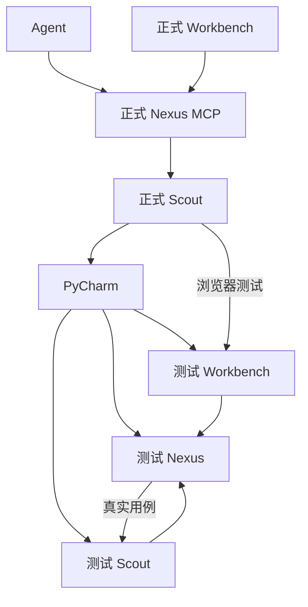

# 支持自进化方案

状态：V6 第十二版（开工清单补充），设计待实施。主文档只定义首期范围和合同；阶段代码依据与工作项见文末实施笔记。

## 1. 目标与边界

**Agent 始终连接正式 Nexus MCP。正式 Nexus 调度正式 Scout，Scout 通过 PyCharm 准备测试项目，Agent 调用 Mino 测试并读取结果。**

- 其他项目：配置 IDE 后支持开发准备→测试→分析；没有 IDE 配置仍可正常测试。
- MINO 项目：包含 Nexus、Scout、Workbench 三个应用，测试通过后可显式更新正式组件，失败时回退到兼容旧版本。
- Agent 自行修改、提交、推送 Git；Mino 不监听、审批或拦截提交，不建设候选准出平台。
- 更新对象是已发布的具体 build，不是工作树；提交不自动触发更新。
- Nexus、Workbench 独立部署与发布，Scout 沿用现有分层安装体系。
- 首期只接 PyCharm、同节点 APK；其他 IDE、跨节点产物交接后置。

首期削减：不实现 verify_only/激活两阶段启动、不自动编排协议预暂存、不整体重构 ensure_db 模式。启动配置隔离、迁移审计及必要局部修复仍需完成。

## 2. 控制链与应用配置



正式 Scout 控制 IDE，测试 Scout 是被测实例；Nexus 不直接操作 IDE/设备。项目进程归 PyCharm，Scout 不另建进程 supervisor。

入口：**项目 → 应用 → 配置 → 开发环境（可选）**。

| 配置 | 内容 |
| --- | --- |
| 开发节点 | 正式 Nexus 中登记的 Scout，明确是哪台电脑 |
| IDE 连接 | 本机 PyCharm MCP URL、传输与可选 header，可按应用覆盖 |
| 项目与运行配置 | 独立填写 IDE 项目路径、应用源码目录和已有运行配置；源码目录不必等于 MCP projectPath |
| 准备步骤 | 构建、启动/重启、安装和就绪探测的适用子集 |
| 测试目标 | 地址、应用、设备及预期环境 |
| 人工步骤 | IDE 接口缺失时需要开发者完成的动作 |

默认推荐一应用对应一个 IDE 项目窗口；支持多应用共享一个项目窗口，并自定义三项映射。当前布局中三应用可共用 MinoNexus 的 IDE projectPath，各自保留源码目录和运行配置；不要求拆窗口，也不假设窗口必对应独立 MCP 端口。

MINO 项目使用同一界面，另绑定三组件正式安装目标及更新权限。项目名、代码路径不授予更新权。Git 链接不等于已在本机打开项目。

## 3. 正式与测试隔离

| 内容 | 正式 | 测试 |
| --- | --- | --- |
| Nexus 程序 | 固定安装版 | 仓库与开发 venv |
| Nexus 地址 | 默认 `http://mino.local:10104` 或登记服务器地址 | 显式地址，例如同机 `http://127.0.0.1:11104` |
| Nexus DB | 登记数据根，已有库优先保留原路径 | `<仓库>/.mino-test/nexus/mino.db` |
| Scout | 正式 URL、scout_id、token、HOME | 测试 URL、独立身份、凭据与 HOME |
| Workbench | 独立正式服务，默认端口 5273 | IDE 开发服务，例如 5274，连接测试 Nexus |
| 其他 | 正式 profile、缓存和秘密引用 | 独立目录，默认关闭 mDNS 广播 |

A 阶段登记正式/测试监听地址和端口，安装前检查占用；预检查不替代启动时的实际 bind 校验。端口冲突直接失败，不自动换号或改连正式端。Scout 通常主动连接 Nexus，不假定存在必须换号的监听端口；辅助监听单独配置。

凭据库/签发配置分离，禁止复制正式 token 到测试。实例 ID/build 用于目标检查与结果溯源。开发入口在路径/数据库副作用前明确数据根，缺配置拒绝；不把现有库重绑定工具当正式启动方案。

测试 DB/WAL/SHM、秘密和登录态不得提交或装包。MINO IDE 节点不能绑定被测 Scout；校验登记身份和配置 revision，无法读取的 IDE 环境由开发者核对，不为此新增安装根注册协议。

设备按测试计划固定归属：正式 Scout 操作独立浏览器中的测试 Workbench，测试设备交测试 Scout；两套 Nexus 的设备租约互不兜底。ADB 可共用本机 server，但不允许双方同时操作设备或擅自 kill-server。

## 4. Workbench 独立启动

拟新增接口（尚未实现）：

```text
mino-workbench dev   --port <端口> --nexus-url <测试地址>
mino-workbench serve --port <端口> --nexus-url <正式地址>
```

开发必须显式传测试地址；正式启动未配置时由启动器填默认 `http://mino.local:10104`。前端只读取启动器提供的运行时配置，不保留隐藏的旧编译地址回退。连接失败不探测其他服务。

页面加载配置后统一创建 HTTP/WS 客户端；变更目标重新鉴权，登录存储按目标隔离，旧 token 不自动发往新地址。部署明确允许的 CORS/WebSocket 来源，不能以来源检查代替认证。

正式包采用独立 Python 运行时与小型静态服务，负责配置、SPA 路由和缓存，不能用开发服务器代替。纯 dist 更新原子切换，旧页面仍需访问对应版本资源；运行时更新才需服务重启。同机可用 `mino.local:5273`，跨主机使用独立地址。

## 5. PyCharm 准备与结果读取

循环外准备走 Nexus 开发准备服务和既有节点 EXECUTE 通信；不伪装成用例 run。循环中的设备执行继续经 RouterProxy。PyCharm 接入登记为启动时自动注册、自动升级版本的系统能力，不要求在 Workbench 手工维护能力条目。新增能力同步合同并检查旧 Scout 支持情况，不无故提升 wire 版本。

Workbench 分别展示“连接”“项目匹配”“可用能力”“目标就绪”，不以连接成功代表可自动重启。Brave 模式由 IDE 控制，不能自动读取时标为未检测；Mino 保留节点/应用授权及配置白名单。状态提示与执行交互见[前端交互合同](实施/B-开发环境前端交互.md)。

用户从 PyCharm 复制“HTTP 流配置”，在 Workbench 粘贴、预览并保存到指定 Scout，再检查连接。复用 Scout config.py 的 JSON 配置，增加 ide_connections 列表：connection_id、url、transport、可选非秘密 headers、revision、最近检查结果；更新时保留其他已有配置。Nexus 只保存节点/连接引用及应用绑定，不另建 Scout 数据库。首期支持本机无需 Authorization 的连接；若实际配置要求 token/header 密钥，明确提示该认证方式待支持，不静默丢弃凭据或把秘密当普通 JSON 保存。秘密存储待该需求出现时再实现。首期接受 HTTP 流配置，SSE 另验；Stdio command/args 不自动执行。

开启 PyCharm MCP 为人工设置步骤：用户在 IDE 勾选启用并应用，保存实际端点后点击重新检查。Mino 不自动开启或修改 Brave。连接拒绝/超时/404 提示检查启用状态及地址，不直接判定缺授权；401/403 提示访问被拒。人工确认“已开启”后仍需技术检查，不直接标连接成功。此前 63342/mcp 的 404 与 64342/stream 的成功不是同端点前后对照。

连接检查需完成 MCP 初始化、工具发现和指定项目配置读取，区分节点离线、IDE 未开、MCP 未启用、认证失败、项目不存在。只允许授权的本机 IDE 端点，凭据不进入日志。

**能用 MCP 就用 MCP**：读取配置、启动、输出以及 IDE 已提供的构建能力都优先调用对应工具。缺专用停止工具时，优先使用已实测的 MCP 终端能力执行本应用的固定停止动作；只有该工具不可用时才由 Scout 本机执行同等受限动作。不给 Agent 开放任意 shell/kill，也不为已具备的能力另建 IDE 插件。实测结论见 [A 阶段记录](实施/A-PyCharm实测结果.md)，产品链与隔离验收仍需实施。

A 阶段验证多项目明确路由；支持 projectPath 等选择器才复用连接，否则配置独立可定位 IDE 实例或人工操作。三个窗口不自动等于三个独立 MCP 服务。正式/测试 Scout 共用 IDE 时互斥，测试 Scout 只操作专用样例项目。

停止条件同时满足：监听端口对应应用测试地址、进程 cwd 对应应用源码目录、进程属主为执行端当前用户，并能核对父进程链来自已连接的 PyCharm。沿用 process_control.py 的 PID+create_time 校验方式，发信号前复核；这些由程序读取，不让用户另登记进程身份。只发 SIGTERM，等待旧进程退出及端口释放；超时报告失败，不升级 SIGKILL。确认停止后调用 MCP 执行原运行配置，再检查输出及服务就绪/版本；没有旧进程则直接启动。无法唯一定位或无权停止时返回具体原因。此停止方式首期验收范围为 macOS/Linux，Linux 须另做实测；Windows 停止适配后置，不能把 psutil.terminate() 当作温和退出。

仅对当前应用的开发准备执行上述停止流程，有活动测试/设备动作时先等结束。已有服务可直接测试，但可访问不等于本轮代码已生效。无监听端口的应用本期不使用按端口停止的后备方案；优先使用实际可用的 MCP 生命周期接口，否则提示人工处理。

准备操作：`queued → running → ready / failed / awaiting_developer / unknown`。持久 operation_id、参数及配置 revision；重复请求复用结果，冲突串行。长驻服务返回 `timedOut=true` 时继续做目标就绪探测，不自动判失败或重发；非零 exitCode 判执行失败，即使 MCP isError=false。HTTP 超时且没有回执时为 unknown，只核对目标或提示人工确认，不重复启动。

| 类型 | 准备与检查 |
| --- | --- |
| Web | HMR 适用则等待生效；否则 IDE 构建/重启，检查实际页面和版本 |
| 后端 | 按语言构建/重启，检查版本、关键接口及用例 |
| APK | 有改动才构建，授权目录读取产物，同节点安装并确认包与版本 |

安装需清数据、降级或签名不匹配时阻断，不自动卸载。

Agent 需能读取任务结果、失败步骤、session 事件/截图、IDE 输出和授权服务日志。复用已有工具，补截图获取和 IDE 输出读取；分页、截断和来源要明确，不开放任意文件读取。

## 6. 开发与自进化循环

1. Agent 改测试代码，正式链经 PyCharm 准备项目。
2. 正式 Mino 执行测试，Agent 读取结果并迭代。
3. Agent 自行提交/推送，CI 发布实际安装包。
4. Agent 显式请求更新指定组件/build；有任务则等待空闲。
5. 更新验证或兼容回退后，Agent 查询原 operation，继续工作。

验证 MINO 时把测试 Workbench 当普通 Web 应用。正式 Scout 从页面创建测试用例，由测试 Nexus 调度测试 Scout；检查实际节点/build、结果及 session。不能以正式 Scout 的执行成功代替测试 Scout 的代码验证。

首期不新建泛化测试 Nexus 客户端。测试侧 MCP 全工具合同回归后置，不能声称 Web 验证覆盖了它；正式更新后的最小 MCP 探测仍必做。

记录保留提交引用、实际 build/包摘要、准备 operation 和 session 引用；测试侧引用带 instance_id。测试库由开发者管理，评估期保留，删除后显示不可读取，重要结果按需导出，不建设独立审批归档平台。

## 7. 发布、安装与更新

### 7.1 统一发布合同

三仓统一使用各自 **GitHub Releases**，共用 versioned manifest schema：component、version/build_id、source_commit、os/arch、runtime要求、protocol/API/schema要求及文件 URL/sha256/大小；Scout 保留 layers 扩展。

统一 schema 是协议文档与校验合同，不新建共享产品仓库。发布到固定 tag/build，latest 仅用于发现；执行时固定 manifest 与文件摘要。旧 Scout 格式保持兼容或提供明确转换，不能直接破坏现有客户端。

Nexus/Workbench CI 从 A 阶段并行开始，在 D2/D3 前产出真实安装包。版本检查代理可按组件显式映射仓库复用，不接受任意 manifest URL 作为下载代理。Git 提交仍不受 Mino 审批。

### 7.2 安装基线

macOS 分别使用 `~/Library/Application Support/MinoNexus/`、`MinoWorkbench/`：

```text
launcher/             稳定启动器、独立助手及运行时
releases/<build_id>/   完整不可变版本
current               当前版本链接
config/               地址、端口及数据根
updates/              操作记录、维护状态与暂存包
```

Nexus 现有 `~/.mino-nexus` 优先登记原路径；新安装可用独立 data/。plist 显式设置数据根，不依赖终端环境；迁移数据另做备份复制校验，保留原件。

应用与更新助手使用不同 LaunchAgent label。助手不属于被停应用进程组，RunAtLoad/KeepAlive 均为 false，按已持久操作 kickstart；应用 plist 固定，更新用 bootout/bootstrap 停启。用户级服务仅承诺登录会话内运行，无人登录服务器采用系统服务；Linux 对应 systemd。

日志有界轮转，不能假定 launchd 标准输出路径自带轮转。服务停止/助手恢复由安装维护命令提供，不依赖 MCP。

### 7.3 MCP 更新与回退

提供检查版本、更新指定版本、查询、取消等待、回退到兼容历史版。按部署权限执行；一部署一更新锁，相同 operation/参数复用结果，不同参数拒绝。

状态：`requested → waiting_idle → installing → restarting → verifying → succeeded`；异常为 failed、rolled_back、needs_operator。

更新记录在执行端持久保存为权威，服务器读取状态；断线返回最后确认状态，不当作失败。Scout 需补固定版本输入和统一旧层保留/回退，各平台分别验收；已有 Windows 失败恢复不是跨平台完整回退合同。

### 7.4 空闲门禁与准入绑定

- Nexus 的 `update_hold` 只阻止受影响范围的新批次/准备操作；现有批次继续步骤、收尾和取消。新排队任务不算活动任务。
- 批次准入记录设备与允许节点，RouterProxy 每次 resolve 后核对；归属漂移 blocked，不动态扩展允许集合。
- hold 持久绑定 operation、范围及截止时间，重注册/重启先恢复门禁。`draining` 仅用于实际停止，不在 waiting_idle 提前设置。
- Scout 更新等该节点全部项目任务与 IDE 操作完成；Nexus 更新等全服务任务及后台写者结束。安装前两端原子复核，不只看心跳空闲。
- waiting_idle 默认 30 分钟，过期/取消只释放该 operation 的 hold；过期与开始安装只有一个转换成功。安装不使用等待阶段超时强杀。
- 新请求返回 `queued`、`blocked_by_update` 和原 task_id；不能排队的接口返回明确冲突。不影响范围外的任务。
- Workbench 纯静态包切换不等待无关批次；联合不兼容更新另用维护窗口。

### 7.5 Nexus 首期升级与回退顺序

首期只自动更新到**验证过旧版可兼容的新版本**。additive 只是候选条件，不自动证明兼容：新增约束、数据语义、bootstrap 和后台任务均可能破坏旧版。

1. **准备与停服**：固定包，等待空闲，持久交接给独立助手；bootout 应用并确认写者退出，取得一致性备份。
2. **离线迁移与切换**：用新 release 的 CLI 执行迁移和 schema 校验；成功后在同目录创建临时符号链接，再原子 rename 替换 current。
3. **正常启动与探测**：bootstrap 原 plist，正常模式启动新版，检查 health、server_info 和 MCP probe。保持业务新任务 hold 至验证完成，但不声称后台零写入。
4. **完成或回退**：成功释放 hold；失败停新版、切旧指针并验证。新版已启动后默认只回退代码，保留当前数据；不能兼容则进入人工维护，不能自动倒库。

离线失败且新版尚未启动、没有新业务写入时，可按记录恢复一致性备份；开始正常启动前保守记录 writes_reopened，不再把旧 DB 当任意可恢复点。

首期不新增 verify_only/激活入口，不整体重构 ensure_db。允许启动重复初始化的前提是**同一迁移实现可重入、重复调用无破坏性效果，且旧版本初始化也兼容当前数据**；有问题只修相关迁移/启动分支，不把未经验证的幂等性当事实。

迁移不兼容、破坏性变化或无法证明旧版可用的版本走人工维护，不开放自动代码回退承诺。正式库副本迁移/旧版启动演练在受控目录进行，不接真实外部业务，不进 Git。

### 7.6 稳定健康检查与 probe

health_contract_v1 固定三项：`/health` 成功；`/sys/server_info` 的实例/build 符合目标；专用 probe token 调 MCP initialize、ping、tools/list 正常。验证目录加载不等于业务用例通过，所需功能冒烟另记录。

token kind 增加 probe，在 RPC 分发前限定方法，拒绝 tools/call；普通 HTTP API 拒绝 probe。认证不更新 last_used_at、不创建助手凭据或交互记录。它限制探测权限，不宣称正常启动中的应用或数据库只读。

助手稳定独立于 current，崩溃后从持久阶段恢复，不因 OS 锁释放就清维护状态。不能恢复时保留本地状态/诊断/修复入口，不能靠 KeepAlive 重试推进事务。

### 7.7 协议变更

首期由管理员在维护窗口协调，停止受影响任务，用本地 CLI/安装器安装**固定兼容版本**的 Nexus/Scout，再验证连接；协议不匹配不自动追 latest。离线节点回来后提示指定版本维护，不能派任务。

不实现协议预暂存自动编排、签名计划或断连自愈。待独立助手和基本回退稳定后另评估。普通更新仍检查应用能力/API兼容，不能仅凭 wire 版本相同免验。

## 8. 实施顺序

| 阶段 | 交付 |
| --- | --- |
| A | 数据根/导入与写者清单、迁移及 bootstrap 可重入审计、端口登记、PyCharm 实测；安装基线和三仓 manifest/CI 并行 |
| B | 应用配置→准备→测试→Agent 读取结果；Workbench 开发地址参数 |
| C | 正式链经测试 Workbench 验证测试两端，记录真实 build/session |
| D1（B 后，与 C 并行） | Scout 固定版本、hold/准入、本地锁、旧层保留与回退 |
| D2 | Nexus 安装/服务登记、离线迁移、正常启动探测、兼容代码回退 |
| D3 | Workbench 独立运行包、运行地址与 token 隔离、切换及恢复 |
| E | Agent 开发提交、显式升级、重连查询并继续循环 |

代码依据、细项和真实验收见：

- [A：审计与基础交付](实施/A-审计与基础交付.md)
- [B：开发准备与结果读取](实施/B-开发准备与结果读取.md)
- [C：MINO测试闭环](实施/C-MINO测试闭环.md)
- [D1：Scout更新与门禁](实施/D1-Scout更新与门禁.md)
- [D2：Nexus安装升级](实施/D2-Nexus安装升级.md)
- [D3：Workbench安装升级](实施/D3-Workbench安装升级.md)
- [E：循环验收](实施/E-循环验收.md)

首期允许明确人工 IDE 步骤，不提供不可信代码沙箱、零停机或任意数据无损回退。未知设备副作用需人工确认。实施遵守仓库规则，以真实会话、构建和隔离安装验证，不将设计完成当作功能完成。
