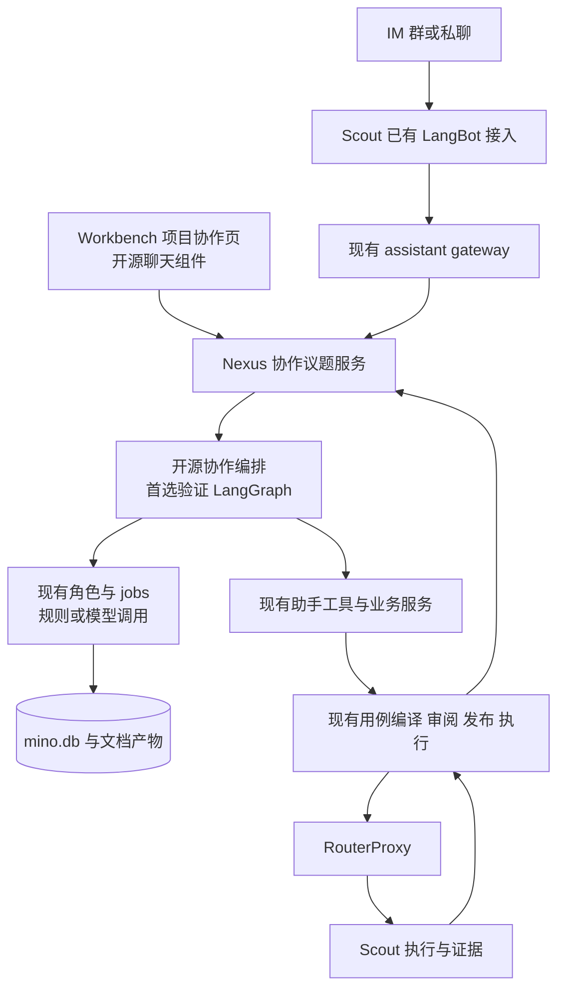

# Mino Bots：最小架构落地与分期验收

> **2026-10-19 流程已修订：本篇保留历史分析依据，人工接受/逐项批准/人工确认后推进的工作流不再有效。当前默认自动校验、自动应用、自动交接与执行；以 [自动推进与 Bot 生命周期设计](MinoBots-自动推进与Bot生命周期设计.md) 和 [全流程交付与现有框架影响](MinoBots-全流程交付与现有框架影响.md) 为准。用户纠正及必要事实补充不是例行审批。**

> 2026-10-18 补充修订：项目协作入口、开源组合及首期优先级，以 [方案复盘与 Workbench 交互设计](MinoBots-方案复盘与Workbench交互设计.md)、[同类项目扩展比较与复用落地](MinoBots-同类项目扩展比较与复用落地.md) 为准；实际价值与验证见 [直接收益与使用优化](MinoBots-直接收益与使用优化.md)。

日期：2026-10-18。**本文件仅为方案，不是本次开发指令。**不安装依赖、不运行候选平台、不改业务数据库，不承诺全部场景首期落地。

建议先读：[产品场景](MinoBots-产品场景与总体方案.md)、[角色与 job 复用](MinoBots-角色Job复用与全流程场景.md)、[开源选型](MinoBots-开源选型与调研依据.md)。

## 1. 最小决策

Mino 已有项目、助手、角色、jobs、文档和真实执行系统。V7 只补“项目协作议题”这一层，把这些已有能力连起来。通用聊天与角色协作机制优先复用开源，不造独立 Agent 平台。

首期保留三个产品角色：需求顾问、方案顾问（交互设计+技术设计）、测试设计师；执行、产品事实检查、报告等是按需调用的已有能力。角色配置先基于模板，不做可视化流程编辑器或 Bot 市场。

明确不做：新前端产品、新微服务集群、新消息中间件、第二套模型密钥、第二套设备执行、通用权限 DSL、任意代码插件市场、全量历史迁移、自动同步来源、自动发布，以及为聊天预先建设知识图谱。

## 2. 当前架构如何承接

- **Workbench**：唯一前端。React 19/Vite/AntD 不替换；优先嵌入 assistant-ui primitives，先对接现有事件；需要标准化 Agent 事件时再验证 AG-UI。OpenMuse 作为交互参考，不再部署它的独立 UI/API。
- **Nexus**：协作、模型调用、业务身份、版本、规则和数据仍在本仓。新业务进入 `services/`，必要新表进入 `models/`；HTTP 路由沿现有命名习惯。
- **Scout**：继续负责设备、浏览器与 IM 插件。Bots 的分析不依赖在线 Scout，但真实执行必须等资源可用。
- **开源编排**：优先验证 LangGraph，与 AgentScope 同案例比较，仅在现有编排不足时使用；简单查询继续现有 assistant 工具链，不强行图化。CrewAI 是替代选项，不叠加。
- **角色/job**：从现有 prompt 真源加载。开源节点调用已有 job 或业务工具，不另存一份 prompt，不引入独立 provider/key。

## 3. 已有资产直接复用表

| 当前资产 | 复用方式 | 需补的薄连接 |
| --- | --- | --- |
| `assistant_gateway/envelope/conversation/receipts/delivery` | 消息身份、去重、请求版本、收据与投递 | 入站消息关联规范议题；多人共享上下文不能复用个人 lane 混存 |
| `AssistantGroupPolicy` | 已有 enabled、allow_execute、disclose_results、project_ids | 检查实际成员与议题权限；项目授权和整群披露独立处理 |
| `assistant_tools` | 继续复用工具白名单和服务调用 | 增加“分析/文档候选/接受版本”等业务工具；不绕过现有校验 |
| `roles_catalog`、`prompt_repo`、`job_store` | 角色定义、jobs、渲染、版本 | Bot 实例绑定角色/job；修正新场景的输入输出合同 |
| `qa_cover`、`qa_process_assist` | 需求分析、脑图、用例和规则建议 | 分离候选生成与结果应用；保留 job 的真实失败/不完整状态 |
| 文档库/应用资料/检索 | 既有项目知识入口 | 增加成果版本和来源引用；不另建 RAG 平台 |
| 需求与 `project_cases` / CaseRevision | 沿用当前业务 ID 和用例版本 | 议题关联现有需求；不能创造第二份同名需求真源 |
| `project_members` 与访问控制 | 保持当前项目权限 | 具体操作检查；不要仅凭群成员或角色名赋权 |
| `development` 与既有工具 | 后期开发准备与产物回流 | 明确任务/版本/文件范围；不新增任意 shell |
| 编译/发布/资源/运行/session 证据 | 测试可信性继续由现有链路负责 | 将结果回挂议题和文档引用 |

当前文档存在历史描述与源码不同的情况：V4 早期写群聊只回复帮助，而当前源码已有群策略；根 README 也仍有 Console/Studio 旧字样。方案以当前 AGENTS.md、V6/V7 范围记录及实际代码边界为准，不据旧文档恢复已取消产品。

## 4. 数据只增加必要概念，暂不提前定一大套表

建议最少新增/扩展下面四类业务对象，具体物理表在实施前与现有模型比对：

1. **Bot 配置**：名字、角色模板引用、job/tool 范围、所属项目、配置 revision。旧个人助手保持兼容。
2. **协作小组/议题**：项目、成员引用、目标、当前负责人、基线引用、待定问题、状态。小组不建立独立组织/租户体系。
3. **议题事件与作业引用**：谁说了什么、引用什么版本、由哪个 job/任务响应，以及必要幂等键。现有任务和收据可复用，不建立第二套任务系统。
4. **文档/决定版本**：不可变版本、来源、父版本、当前接受指针、与需求/用例的引用。文档库负责内容及检索，SQLite 保存业务状态；导出 Markdown 是交付副本。

未验证需要前，不做独立 Requirement Graph 服务、通用审批表族、嵌套团队层级或跨实例消息总线。

### 4.1 需求真源与版本

当前 `qa_process.requirements` 和项目用例关系已经存在，应先保留其 ID/服务入口。V7 可增加不可变快照与接受指针作为版本层，禁止一边维护旧需求、一边让 Bots 自建同名需求库。没有明确需求的历史内容不自动迁移；新议题显式关联旧需求或创建新需求。

### 4.2 消息真源

IM 正文仍以 Scout 渠道历史为准，Nexus 记录引用和已有范围内的脱敏追踪。不能为了团队记忆自动把所有私聊搬到 Nexus。用户主动加入项目协作的内容，可形成带来源、权限的业务摘要/决定/文档。

新增 Workbench 协作消息是新的业务输入，可由 Nexus 按项目权限保存；启用时明确其共享范围。IM 内容需要持久进入议题时明确选取/共享，保留来源与权限，不把“引用一条消息”解释成导入整个群历史。Scout 离线时只显示可用材料与“原始消息暂不可取”，不编造全文。

## 5. 最小行为合同

### 5.1 同一任务只能有一个当前负责人

讨论可多人同时参与，文档候选可并行生成；接受基线、发布/执行等关键业务写入采用现有事务与版本比较。并行角色各自提交建议，不互相覆盖。相同消息重投返回已有 task/job 引用。

输入身份来自认证会话或已验证 IM 绑定；后台任务固化 execution_owner。Bot 名称、群管理员、请求体 user_id 都不能改变执行账号。项目撤权、解绑或群披露权限变化在工具执行和发送前复核。

### 5.2 接受候选与执行动作分开

讨论/分析/写草稿在既定范围内直接进行。只有接受业务基线、发布用例、执行有副作用任务等使用现有授权机制；用户已对明确范围授权的不反复确认。群里一个“好”必须能唯一绑定当时的具体提案和版本，否则先定位提案。

### 5.3 编排恢复不能重放未知副作用

采用 LangGraph 等框架的检查点能力，但业务服务先落幂等收据，成功后节点保存结果引用。崩溃窗口里先查既有任务/收据，再决定是否继续；设备未知写和外部未知结果继续按现有规则隔离/对账。框架“可恢复”不等于每个工具调用都可以再执行一次。

若使用单独检查点存储，它只保存编排技术状态和业务 ID，不承担需求、授权、任务状态的第二真源；按既有 SQLite 并发条件验证。首期不为此引入 Redis/Kafka/PostgreSQL 集群。

### 5.4 产物都带版本与证据

需求、交互、技术、测试文档分别引用输入版本；用户点“生成新版本”不修改已被执行引用的旧内容。迟到 job 只能产生旧基线候选。报告统计从权威任务服务取得，模型只负责解释，不重新计算一套不同分母。

### 5.5 有预算、有限角色，不做无限协商

使用已有任务预算和模型计量，记录角色/job 用量。分析缺信息即等待并展示问题；无新增信息的多角色循环停止。规则可以解决的调度不调用额外模型。框架集成只增加必要配置，不给用户堆满几十个 Agent 参数。

## 6. 首期页面与操作

现有项目导航增加协作视图：左侧议题，中间讨论，右侧成果。角色模板从现有目录选择；默认组合一键创建。不替换当前助手设置、节点配置和用例页面。

首期只需要这些操作：创建议题、添加现有项目成员、选择角色模板、发消息/@角色、回复某段文档、接受/拒绝候选、查看版本差异、从候选进入现有用例流程、查看关联任务与证据、暂停/继续任务。

API 先复用现有助手/项目/任务接口；只有议题、Bot 配置和文档候选缺口新增路由。此阶段不提前固定完整 REST 清单，也不要求外部系统先支持新协议才能开始使用。

## 7. 分期：一次做成一个用户闭环

### P0：仅验证开源适配，不开发平台（后续经安排再做）

用一个真实需求比较选定聊天组件与现有事件的适配成本，并按缺口比较 LangGraph/AgentScope，验证引用、角色交接、中断、账号隔离与既有 job 调用。只做最小垂直链；若现有助手足以完成简单工作，不扩大框架接入范围。

准出：选定一个 UI 组件，证明是否需要新增编排库（允许沿用既有编排）；明确版本/许可/外发行为；无外部云会话强依赖；能够调用现有分析 job 并返回有引用的结果。不能通过则记录具体缺口，优先换候选组件，不从零补成通用系统。

### P1：需求—设计—开发文档—测试设计的持续协作

Workbench 内建立项目议题，3 个角色模板，复用分析/脑图/用例 jobs；增加必要澄清和方案文档产出；能引用文档继续沟通并形成新版本。执行仍使用现有界面和任务链。

准出：一个真实新增需求和一个现有功能变更，在成员共同讨论后形成可交接开发文档、测试方案和候选用例；隔日继续不丢待定项，冲突不覆盖，候选不自动发布。

### P2：真实测试、缺陷与 IM 议题接入

把用例编译/审阅/执行和证据回挂串起来；支持群报缺陷和受控分享。先选一个真实 IM 渠道，逐项验证线程/引用/重投/撤权，不宣称所有渠道同时支持。

准出：原缺陷→复现证据→修复 build→原条件复验闭环。无资源、断线、取消和未知写显示准确；其他成员不能借用发起人的身份。

### P3：确有收益才扩展

独立设计/开发角色、编码工具接入、跨议题版本准出、团队模板。自动化例行任务必须独立明确范围，不因开源库自带 cron 就恢复被取消的源同步/自动发布。APK 等沿现有 V7 条目排期。

暂不按周给虚假工期。P0 后根据实际可直接复用程度估算 P1，避免把“产品场景很多”误解为“首期全部开发”。

## 8. 必要验收，不建设新测试平台

沿仓库现有验证方式，用隔离数据目录、HTTP、真实 Workbench 浏览器和 session/任务记录验收，不提交 tests/mock，不跑 pytest，不造专用测试版本面板。

| 验收案例 | 必须能看到的结果 |
| --- | --- |
| 群成员 A 提需求，B 补规则 | 同一议题聚合，贡献者和来源可辨，A/B 权限分别校验 |
| 私聊和群聊交替 | 未明确共享的私聊内容不会出现在群或项目检索 |
| 需求有冲突/缺关键规则 | 待决定项明确，独立工作继续；没有虚构“已确认” |
| 原文长、用例多、输出截断 | completeness 明确；不会把前 40 个用例冒充全库对照 |
| 文档 v1 生成中，人已接受 v2 | 迟到结果不覆盖 v2；可供人工对比 |
| 重复消息、断线重连、服务重启 | 不重复创建任务/执行，恢复原 task/job 引用 |
| 停止时操作已派发 | 显示真实 effect/停止状态，不显示“已撤回全部动作” |
| 需求已变、旧版本测试通过 | 并列展示旧通过与新版本未验证，不能挪用结果 |
| 模型缺配置、预算不足、Scout 离线 | 准确阻塞，保留成果；不借其他账号或伪造完成 |
| 多角色没有新增价值 | 可退回单角色处理，不强迫完整群聊流程 |

## 9. 本轮范围与产物

本轮交付四份方案文档：产品场景、角色/job 复用、开源选型、最小落地。保留 V7 原需求池和取消决定，仅增加方案入口。不改运行代码、不安装开源项目、不启动服务、不变更真实业务数据。
