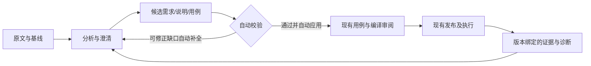

# Mino Bots：需求、用例分析如何反馈并闭环

> **2026-10-19 流程已修订：本篇保留历史分析依据，人工接受/逐项批准/人工确认后推进的工作流不再有效。当前默认自动校验、自动应用、自动交接与执行；以 [自动推进与 Bot 生命周期设计](MinoBots-自动推进与Bot生命周期设计.md) 和 [全流程交付与现有框架影响](MinoBots-全流程交付与现有框架影响.md) 为准。用户纠正及必要事实补充不是例行审批。**

日期：2026-10-18。以下是建议的业务合同；不代表现有接口已支持所有字段。

## 1. 不把长篇回答当成果交付

每轮分析应同时给用户三层信息：聊天中 5～10 行的结论摘要；可逐项处理的成果列表；可追溯的原始来源与执行证据。用户能回答“发现什么、为什么、影响谁、我现在要做什么”。

摘要示例：需求 r4 相对 r3 新增 2 条验收点；关联 6 条现有用例，其中建议修改 3 条、新增 2 条、1 条待业务确认。这里的数字只是界面示例，不是项目实际统计。

## 2. 最小闭环

接受文档不自动执行测试；接受用例不跳过现有编译/发布条件；任务完成不代表断言通过。业务状态仍保存在现有数据库，不另建报告 JSON 真源。

## 3. 四类反馈对象

| 对象 | 内容 | 用户动作 | 后续 |
| --- | --- | --- | --- |
| 需求问题 | 原文、问题、为何影响验收、选项/待补事实 | 补充、暂缓、明确不在范围 | 修订对应需求项，不重写无关项 |
| 方案建议 | 前后差异、交互/接口/异常、取舍与可测性 | 接受、修改后接受、拒绝附原因 | 更新开发说明与受影响测试点 |
| 用例候选 | 来源验收点、前置、步骤、预期、目标平台、疑似重复 | 选中接受、修改、合并建议、拒绝 | 经现有用例服务生效，返回真实 ID/revision |
| 失败诊断 | 现象、实际证据、推断、缺信息、建议负责人 | 补资源、修原文、建缺陷、申请复验 | 原 session 保留，新增复验记录 |

没有证据时显示“推断/待验证”。不输出没有依据的置信度百分比。

## 4. 最小字段与版本关系

成果需有稳定 item_id、type、project/app scope、source_ref（对象 ID/revision/段落或验收点）、base_revision、run_id、内容/差异、理由、处理状态、接受后的目标引用和操作者。字段可优先复用现有模型，不据此一次性新建十张表。

评论绑定 artifact_id＋revision＋block_id/item_id；引用原文作为辅助。既有 caseAnnotations 仅在精确文本唯一命中时定位，重复文本不能猜测归属；跨版本段落移除时保留旧评论并显示失效。

需求→验收点→用例是显式关系；执行证据另外带 case revision、发布版本、execution_unit、attempt、build、平台和资源身份。不用“最新结果”覆盖历史事实。实现前确认已有字段可用性，缺失字段显示未知。

## 5. 自动应用动作的最小可靠性（取代人工接受）

1. 校验登录用户项目权限和作用域，执行身份来自认证与持久 owner。
2. 检查候选基于的 revision 仍有效；失效则返回冲突与差异，不覆盖。
3. 每项接受具备幂等标识；重试返回原结果，不重复创建用例。
4. 调用现有业务服务保存，返回真实目标 ID、版本和处理结果。
5. 批量接受采用逐项明确成功/失败；已成功项不重复执行，失败项保留草稿。
6. 后续编译异步时显示“已保存，待编译”；不能因编译失败隐去已经保存的事实。

文档单项修订可原子提交；跨用例批次不许假装全成功。已经执行或被引用的版本不做一键历史回滚；撤销产生新修订或显式归档。

## 6. 常见分析质量问题与补救

| 问题 | 检测/呈现 | 处理 |
| --- | --- | --- |
| 输出被截断、结构不完整 | 校验结构、完成原因和预期范围；标部分结果 | 保留可用候选，显式补全；不宣布全面覆盖 |
| 既有用例只读取前 40 条 | 显示实际参考范围 | 按范围分批检索，候选去重前再查库；不能宣称全库无重复 |
| 用户只改一个验收点却全量重写 | 显示受影响 item 列表 | 默认增量修订，未受影响项保留 |
| 模型把旧需求当当前事实 | 来源版本与已接受基线对比 | 旧版本仅参考；基线变更提示过期 |
| 新用例与既有用例近似 | 列出相似项和关键差别 | 人决定保留/修改/合并，文本相似不等于业务相同 |
| 设计与测试结论冲突 | 同一问题显示不同建议及证据 | 指定责任人裁决，不让 Bot 无限辩论 |
| 用户说“可以”范围不明 | 界面明确当前接受对象及数量 | 自然语言不自动扩大成全批接受或执行授权 |
| 重复消息或中断恢复 | 关联既有 request/run/receipt | 查询已有状态，避免重复生成/应用 |
| 无设备或无账号 | 分析照常，执行明确阻塞 | 展示可采取配置动作，不编造执行结果 |

## 7. 覆盖与质量如何反馈

最小覆盖表按验收点展示：需求版本、关联用例数、已审阅数、执行目标、通过/失败/阻塞/未测、最后证据、待确认问题。用例数量不是覆盖率，关联存在也不等于测试通过。

分母由用户确认的版本与范围构成；排除项必须给理由。Web、Android、iOS 独立统计；设备 A 成功不自动使设备 B 通过。需求变更后，旧成功记录标“旧版本证据”而非删除。

若 10 个验收点只有 6 个有关联用例，展示“设计关联 6/10”；若其中只有 4 个完成有效执行，不写“覆盖率 60%”或“通过率 100%”掩盖未测范围。发布结论引用完整分母和剩余风险。

## 8. 不同角色看到什么

产品主要看规则歧义、范围与验收点；设计看交互状态和异常路径；开发看接口约束、实现任务与失败复现；测试看用例差异、资源缺口和证据；负责人看阻塞、待确认与交付风险。它们是同一成果的筛选视图，不是五套互相同步的数据。

## 9. 首期可交付范围

P1：结构化需求/用例结果、引用评论、版本对比、自动校验应用、冲突自动重算与反馈、原用例/任务链接。P2：执行事件回挂、缺陷复验聚合和一个 IM 渠道。外部需求源写回、周期同步、全面知识图谱和自动发布继续不做。

验收用新增需求、变更、失败复验各一条真实链，另外覆盖并发修订、部分失败、截断、跨用户访问和多执行目标。按项目规则保留实际任务/session 证据，不新增或运行 pytest。
