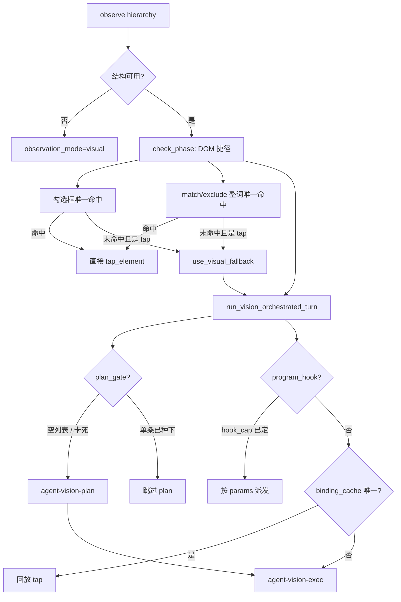

# DOM 定位链优先、模型规划兜底（2026-10-26）

> 状态：**P0/P1 已落地；P2 Nexus 侧已落地（2026-10-27）**。Workbench 展示页仍在前端仓。
> 抽象：`LocatorPlatform` 一套接口，android / web / mac / win 各自实现结构链；禁止把 Android 键顺序套到其它端。执行路径不带合同版本号。
> 范围：用例执行回合里「点谁 / 填哪」的决策顺序。
> 不改变：Scout 设备通道、能力目录、execution_binding、check 视觉断言、Nexus 不直连设备。

---

## 0. 结论

**可行，且建议做。P0 可以只在 Nexus 执行环倒换优先级，不改协议、不改 Scout、不改 Workbench。**

当前真正的倒置不在观察层，而在决策层：

| 层 | 现在 | 要改成 |
|---|---|---|
| 观察 | 已是 `dom_preferred`：结构可用就不送图 | 保持 |
| 执行载荷 | `point_policy=node`，坐标只作 `fallback_xy` | 保持 |
| **点谁** | 程序钩 / 指纹缓存 / 唯一 match 是捷径；其余走 `agent-vision-exec` | **定位链唯一命中直接派发** |
| **还要不要追加步骤** | `do_program_plan` 已锁 append；空列表才叫 `agent-vision-plan` | 规划 Job 只在链失效、程序图缺步、挡屏时出场 |

模型不能从跑批里删掉。自绘 / Flutter 空 `resource_id`、列表重复文案、check 视觉预期、挡屏恢复，仍然要它。改的是：**有结构锚点时不再付一次规划/执行模型调用。**

编译期如果仍只有步骤标题、没有锚点，P0 落地后第一次跑仍会 miss → 模型兜底。要让冷启动也少调模型，必须做 P1（把控件/导航边上的定位写进程序图）。

---

## 1. 要解决的问题

作者写的是「点击提交」「输入手机号」这类步骤。编译已经能产出 `do_program_plan`（能力、意图、偶尔 `target` / `spatial_hint`）。真机上也有 hierarchy。

但多数操作回合仍会进 `run_vision_orchestrated_turn` → `run_vision_exec_turn`：由模型对着 hierarchy 或截图再选一次 `tap_element` 参数。后果：

1. **同一控件每次重规划**，耗时和失败面都在模型。
2. 模型给的是文案 + 千分比坐标；Scout 锚点没命中就靠坐标吸附，历史事故是点到「?」。
3. 程序图已经锁了「不许再追加业务边」，模型却还在为「点谁」付费。
4. 结构不唯一时立刻 `use_visual_fallback`，把本来能用父节点/空间提示消歧的 DOM 步赶去看图。

这和 V2「看图规划」的原设计一致：当时程序图还薄，模型同时负责规划步骤和挑选落点。2026-10 之后程序图、意图图、控件表、指纹缓存都已经在，主路径可以倒过来。

---

## 2. 现状（按真实调用顺序）

一次 do 回合，决策相关顺序如下。



已有、可复用的积木：

| 积木 | 文件 | 现在做什么 | 缺口 |
|---|---|---|---|
| DOM 优先观察 | `action_space/scheme.py` | `dom_preferred` 为默认；`visual` 入口已归一 | 决策层未跟观察层对齐 |
| 唯一结构锚点 | `scheme.structure_target_nodes` | 只认 `node_ref` **或** `resource_id` **或** 整词文案，命中必须 = 1 | 没有链，没有父约束 |
| 意图整词点选 | `loop/intent_tap.py` | 里程碑带 match 表且树上恰好一个可点节点 | 没有 match 的普通步骤走不到这里 |
| 指纹缓存 | `loop/binding_cache.py` | 同设备同程序图记住 resource-id / 整词，不记坐标 | 只在 orchestrator 末尾、LLM 之前；冷启动空 |
| 程序钩直派 | `milestone_orchestrator.program_hook_to_dispatch` | `hook_cap` + `params` 不再问模型 | params 经常只有 `spatial_hint` |
| 控件表 | `knowledge/control_registry.py` + `ui_controls` | playwright / uiautomator / ax / uia / vlm_text | Web 发布格仍走已有 Workbench 合同；其它端只写选择器 |
| 编译产物 | `case_step_key_compiler` → `do_program_plan` | 能力、意图、空间提示、偶发 `target` | **没有 locator_chain 字段** |
| 规划锁 | `vision_plan.filter_plan_milestones_append` | 有 do 程序图时拒绝模型追加业务边 | 规划 Job 仍可能被 plan_gate 拉起来做挡屏判断 |

关键事实：**「DOM 优先」已经写在方案名和观察门上，但「点谁」的主路径仍是模型。** 覆盖度文档（2026-10-24）也写过：执行主链仍是 planner 选工具。

---

## 3. 目标架构

把一步操作拆成两段，程序先走完，模型只接漏。

```text
本步能力（程序图） + 本步定位链（控件/导航/缓存/编译）
        │
        ▼
  对当前 hierarchy 按优先级解析
        │
        ├─ 唯一命中 → 装配 EXECUTE（point_policy=node + fallback_xy）→ Scout
        ├─ 0 命中    → 记 locator_chain/miss → 模型兜底（vision-exec，必要时 vision-plan）
        └─ ≥2 命中   → 用父节点 / spatial_hint / 角色 消歧
                       仍不唯一 → 记 locator_chain/ambiguous → 模型兜底
```

### 3.1 定位链（Android）

优先级只表达**稳定性**，不表达 App 文案含义。禁止在链生成或匹配里写死被测 App 的 Tab/按钮字面量。

| 序 | 键 | 来源 | 唯一性 |
|---|---|---|---|
| 1 | `node_ref` + `snapshot_id` | 本轮观察 | 本轮有效；跨观察作废 |
| 2 | `resource_id`（去包名前缀） | 控件表 / 导航边 / 编译 / 缓存 | 全树唯一才接受 |
| 3 | `content_desc` 整词 | 同上 | 全树唯一，或 + 父 `resource_id` |
| 4 | `text` 整词 | 控件 `vlm_text` / 链上已有文案 / match / 导航边 | 全树唯一，或 + 父 `resource_id`；**不要求先有 resource_id** |
| 5 | 角色 + 文案（checkbox / EditText） | 控件 `element_type`、里程碑 `element.role` | 角色集合内唯一 |
| 6 | 父约束 + 文案 / 空间槽 | `spatial_hint`、父 id | 消歧用，不能单独作为第一锚 |
| 7 | 坐标 | 节点 bounds 中心 → `fallback_xy` | 只随锚点下发，不单独作为命中 |

**不把 xpath / class+index 放进 Android 主链。** 页面入口方案附录 D 已否决把 Playwright `getByRole` 顺序照搬到 Android；xpath 在原生树上比坐标更脆，也更容易在自绘页上假命中。

### 3.2 定位链（Web）

键顺序与已发布的 Workbench 控件格一致，执行链本身不带版本号：

`test_id` > `role+name` > `label` > 受约束的 `css`。

css 继续禁止 `xpath=`、`text=`、`nth`、`:has` 等（现合同已禁）。Web 没有发布 locator 的步骤，走与 Android 相同的 miss → 模型兜底。

### 3.2.1 定位链（mac）

mac 的结构树是 Accessibility（AX），不是网页 DOM，也不是「没有定位链」。`MacLocator` 顺序：

`node_ref` > `identifier`（AXIdentifier / accessibility_id）> `title` > 角色 + 名称。

树上唯一命中直接派发。树空或 0 命中记 `locator_chain/miss`，再看图兜底。不因平台是 mac 就 skip。

### 3.2.2 定位链（win）

win 的结构树是 UI Automation（UIA）。`WinLocator` 顺序：

`node_ref` > `automation_id` > `name` > 角色 + 名称。

同样：唯一命中直派，空树 / 不唯一才 miss → 看图。不因平台是 win 就 skip。

### 3.3 模型改成什么角色

| Job | 现在 | 改后 |
|---|---|---|
| `agent-vision-plan` | 空里程碑、单焦点、挡屏、准出 | **兜底规划**：程序图缺步、链连续 miss、挡屏、卡死重规划。有 in_progress + 链可解析时**不调用** |
| `agent-vision-exec` | 无 hook / 无缓存时的主执行 | **兜底选点**：`locator_chain/miss` 或 `ambiguous` 之后才调用。命中时整段跳过 |
| `agent-vision-assert` | check 视觉预期 | **不改**。DOM 断言能做的继续做结构谓词；视觉预期仍要模型 |
| `intent-choice` | 编译/预演选意图 | 不进执行主链；保持编译期 |

规划 Job 的挡屏识别（`screen_obstacle`）P0 仍留给模型；P1 可把「树上有 dialog 角色节点」收成程序规则，只在结构说不清时再问模型。

---

## 4. 可行性

| 题目 | 判断 | 依据 |
|---|---|---|
| 执行环倒换（P0） | **高** | 捷径已经存在，只是分散且太窄；hierarchy 每回合都在 `ctx.nav_hierarchy_nodes` |
| 载荷形状 | **高** | `assemble.py` / `dom.py` 已输出 `target` + `selector_text` + `node_ref` + `fallback_xy`；Scout 不必新协议 |
| 冷启动少调模型（P1） | **中** | 编译产物多数没有稳定锚点；要接 `ui_controls`、导航边 `execute`、控件-页面绑定 |
| 完全去掉规划 Job | **低，不建议** | 程序图覆盖不了探索步、挡屏、缺入口、Flutter 空树 |
| 列表/重复「确定」 | **中** | 现规则命中 ≠ 1 就视觉化；链必须带父约束/空间槽，否则 P0 会把这些步继续交给模型（行为不退化，收益变小） |
| 自绘页 | **本来就要模型** | 空 resource-id、无 text 的节点，链应诚实 miss，禁止用 class+index 猜 |
| 协议 / 两仓同步 | **P0 不需要** | 不改 `point_policy` 语义，不新增 EXECUTE 字段 |
| Workbench | **P0 不需要** | P2 才需要展示链与 miss 原因 |
| 硬编码 App 文案 | **必须禁止** | 链的 text 来自控件表/用例/树上节点，不来自代码白名单 |

**P0 单独上线是安全的**：命中则少一次模型；未命中走今天同一条视觉/模型路径。失败模式与现在相同，不引入新的「程序把能跑的步卡死」——只要 miss 时继续交给模型，而不是记成 `tap_target_unresolved`。

这和 2026-10-26 自阻塞清单 2.1/2.2 对齐：DOM 方案不能再把坐标抹掉后无路可走。链 miss ≠ 用例失败。

---

## 5. 改动成本

人天按「熟悉本仓循环的一人」估计，含 session 对账，不含 Scout 发版。

### 5.1 P0 — 运行时倒换（建议先做）

**目标**：当前回合只要链能唯一命中，就不再调用 vision-plan / vision-exec。

| 工作 | 文件 | 规模 | 说明 |
|---|---|---|---|
| 统一解析器 | 新建 `action_space/locator_chain.py` | ~250 行 | 输入链 + 当前节点，输出唯一节点 / miss / ambiguous；session 事件 |
| 捷径收口 | `loop/intent_tap.py`、`binding_cache.py`、`scheme.py` | 改 3 处调用，不重写 | 变成链的 1/3/4 层，不再各写一套匹配 |
| 插到模型前面 | `loop/execution/check_phase.py`、`loop/milestone_orchestrator.py` | 各一处分支 | orchestrator 在 `program_hook` 之后、`try_replay_decision` 处改为 `resolve_locator_chain`；命中则 `OrchestratedTurn(decision=…)` |
| 装配 | `action_space/assemble.py` | 小 | 命中节点写入 target / node_ref / fallback_xy，沿用 `apply_dom_point` |
| 事件 | `records/eventlog/writer.py` 或现有 append | 小 | `locator_chain/hit` `miss` `ambiguous`，带 used_key、hit_count，不写坐标到业务库 |
| Prompt | `prompts/jobs/agent-vision-exec`、`agent-vision-plan` | 小 | 标明「仅在程序定位失败后出场」，避免模型以为自己是主路径 |

**不做**：新表、新协议、Workbench、Android `locator_spec` 合同。

**预估：3–5 人天。** 回归看 `session_events`：有稳定 id 的 tap 应出现 `locator_chain/hit` 且本回合无 `model/call`；Flutter/空树仍有 `locator_chain/miss` 后接 `vision_exec`。

### 5.2 P1 — 让冷启动也有链（收益真正变大）

**目标**：`do_program_plan.steps[].locator_chain` 在保存/编译时写好。

来源优先级（写入，不是运行时匹配）：

1. 已发布 / 已填写的 `ui_controls` 对应该步骤 `control_id`
2. 导航边 `execute.resource_id` / `selector_text`（`nav_route` 已在采集时 `fill_locator`）
3. 控件-页面绑定（`control_page_binding.py`，2026-10-26 已有）
4. 编译从步骤结构里抽出的 `target`（现有 `_step_from_hit`）
5. 空间提示只作为消歧，不作为第一锚

| 工作 | 文件 | 规模 |
|---|---|---|
| 编译挂链 | `casework/case_step_key_compiler.py`、`loop/do_program_plan.py` | 中：步骤 schema 加字段，里程碑带下去 |
| 读控件格 | `knowledge/control_registry.py` | 中：Android 读 `uiautomator` 格，不要误走 Web `locator_spec` 校验 |
| 块内步骤 | `loop/flow_block_executor.py`、`nav_flow_block_catalog` | 中：块步骤同样带链，避免「块有 match 文案、树上无锚点」再踩 `system_dialog_block_failed` |
| 页面一致 | `casework/control_page_binding.py` | 小：解析时用 `page_state_id` 收窄候选 |

**预估：5–8 人天。** 不改 Scout。可能要给 `do_program_plan` 一个小的 schema 版本字段，旧用例重编译后才带链。

### 5.3 P2 — 合同与回写（可后置）

| 工作 | 成本 | 备注 |
|---|---|---|
| Android / mac / win 的 `locator_spec` 选择器（无版本号） | 5–8 人天 + Workbench 控件配置 | Web 发布格仍走已有 Workbench 合同；其它端只校验 kind/value，不发明 `*.locator.v1` |
| 命中回写 `ui_controls`（draft，不自动 publish） | 2–3 人天 | 唯一命中即回写，键可以是 text / role / content_desc / resource_id；只补空格，不自动 publish |
| Workbench 展示链 / miss | Workbench 仓，3–5 人天 | 本仓只提供只读 API |
| 挡屏结构化 | 3 人天 | dialog 角色节点走程序恢复，模型只看结构说不清的 overlay |

P2 才可能动协议（若要把链原样塞进 EXECUTE 让 Scout 自己走阶梯）。**P0/P1 不需要**：Nexus 解析完再下发单点，符合「Scout 不读 YAML、载荷必须算完」的铁律。

### 5.4 明确不增加的成本

- 不引入 bdd2pw / Playwright 代码生成（入口图谱方案附录 D 已否）。
- 不把定位链生成器做成新的 LLM Job。
- 不改 `../MiniOrangeServer`。
- 不为验证加 `tests/test_*.py`；用 `session_events` + `compileall` + `arch_report --check`。

---

## 6. 风险与对策

| 风险 | 等级 | 对策 |
|---|---|---|
| 命中多个「确定」仍交给模型，P0 收益看起来很小 | 中 | P1 强制父约束；session 统计 `ambiguous` 占比，专治高频文案 |
| 把 miss 记成失败（重蹈坐标抹掉） | 高 | miss 只写 `locator_chain/miss`，`execution_started=false`，然后模型兜底；禁止 `tap_target_unresolved` |
| Flutter 空树被 class+index 假命中 | 高 | Android 主链不含 xpath/index；空锚直接 miss |
| 输入把待填值当 selector | 已踩过 | 保持 `input_text.text` 不参与匹配 |
| 程序图过时，链指到旧控件 | 中 | 链命中后仍要看排除表（现有 `tap_surface_blocks_pass`）；连续 semantic reject 再转模型 |
| 规划 Job 不再跑，挡屏没人报 | 中 | P0：链 miss 或树上 dialog 仍可进 plan；P1 再收 dialog 规则 |
| 与 execution_binding 输入组合不一致 | 中 | 仍走 `stamp_scheme_params` + `input_combination`；Android 输入继续 `current_focus+append` |
| 跨设备缓存误命中 | 低 | 现缓存已按 sn/package/程序图版本分桶，继续用 |

---

## 7. 验收口径

只认 session，不写单测。

| 场景 | 期望事件 |
|---|---|
| 树上 `resource_id` 或整词文案唯一，步骤链含该键 | 本回合 `locator_chain/hit`（used_key 为实际命中键），**无** `vision_exec` / `model/call`，随后 `device/action` pass |
| 整词唯一、无 id | `locator_chain/hit` used_key=text 或 content_desc |
| 两个「确定」、无父约束 | `locator_chain/ambiguous` → `vision_exec`（与今天等价，不算回归） |
| 空树 / 自绘 | `locator_chain/miss` reason=structure_empty → 视觉/模型；不得 `tap_target_unresolved` |
| check 视觉预期 | 仍走 `agent-vision-assert`；本方案不宣称 check 去模型 |
| 同设备第二次跑同一程序图 | `binding_cache` 或链 hit，模型次数下降 |

建议先拿 2 条对照：一条原生 id 齐全的登录/表单，一条自绘主按钮。前者应明显少模型调用；后者允许仍走兜底。

---

## 8. 建议落地顺序

1. **先合 P0**（本周可做）。行为保守、可回滚（一个分支开关即可：链 miss 时路径与现网相同）。
2. **紧接着 P1**，否则 P0 在真实业务用例上「看起来没改」——因为编译产物没有锚点。
3. **P2 等 P0/P1 的 session 比例说话**：`hit / (hit+miss+ambiguous)` 在原生页过 70% 再上 Android locator 合同和 Workbench。
4. **不要**并行改 vision_plan 的准出/挡屏语义；倒换定位后再收规划 Job，避免一次 diff 里两套因果。

开关建议：`execution.locator_chain=on` 写进 session_meta，默认开。关掉即回到「DOM 捷径 + 模型主路径」。不需要用户在用例上再选 visual。

---

## 9. P0 落地（2026-10-26）

| 项 | 位置 |
|---|---|
| 统一解析器 | `action_space/locator_chain.py` |
| 直派 / miss 记账 | `loop/locator_dispatch.py`（事件 `locator_chain/hit\|miss\|ambiguous`） |
| 模型前插入 | `loop/execution/check_phase.py`、`loop/milestone_orchestrator.py` |
| 结构唯一性 | `action_space/scheme.py` 改走同一解析器 |
| 编译带链 | `case_step_key_compiler`、`do_program_plan` 复制 `locator_chain` / `control_id` |
| Prompt | `agent-vision-plan` / `agent-vision-exec` / `agent-decide` 标明仅兜底 |
| 关闭 | `meta.locator_chain=off` 或 `ctx.locator_chain=off`；关时仍走旧指纹回放 |

miss 不再触发 `use_visual_fallback` / `tap_target_unresolved`。点选类 `program_hook` 空参不再直派，交给链或模型。`agent-vision-assert` 未改。需要重启 Nexus 后 prompt 才生效。

---

## 10. P1 / P2 落地（2026-10-27）

一套 `LocatorPlatform`，四个被测平台各自实现：

| 平台 | 类 | 键顺序 | 空链时 |
|---|---|---|---|
| android | `AndroidLocator` | node_ref → resource_id → content_desc → text → role_label | miss → 模型 |
| web | `WebLocator` | node_ref → test_id → role_name → label → css → text | miss → 模型 |
| mac | `MacLocator` | node_ref → identifier → title → role_label | miss → 模型 |
| win | `WinLocator` | node_ref → automation_id → name → role_label | miss → 模型 |
| 编译期未绑设备 | `SharedLocator` | 四端键并集 | 只给跨端块（协议/登录）预填 match |

| 项 | 位置 |
|---|---|
| 平台策略 | `action_space/locator_platforms.py` |
| 门面 / 编译挂链 | `action_space/locator_chain.py`：`attach_to_row` 吃控件表、导航边 `execute`、块 `match` |
| 块内步骤 | `milestones_from_flow_steps`、prep/do 展开逻辑块时挂链（修 `privacy_choice` chain_empty） |
| 选择器校验 | `contract/locator_spec.py` 按平台校验 kind/value；Web 发布格仍走已有 Workbench 合同，执行链不带版本号 |
| 命中回写 | `fill_locator` + `fill_locator_spec_draft`，只补空格，不 publish。mac 写 `ax` 格，win 写 `uia` 格 |
| 只读 API | `GET /case-runner/sessions/{session_id}/locator-chain` |
| session 开关 | `runtime_context.locator_chain`（`enabled/platform/structural`） |
| 编译合同 | `COMPILE_CONTRACT_REVISION=17` |

Workbench 展示链 / miss 仍在前端仓。P2 不把链原样塞进 EXECUTE。
